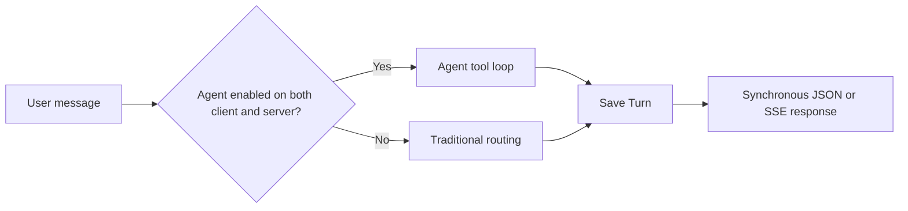
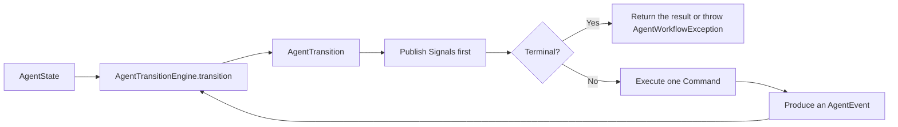
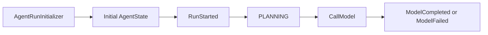
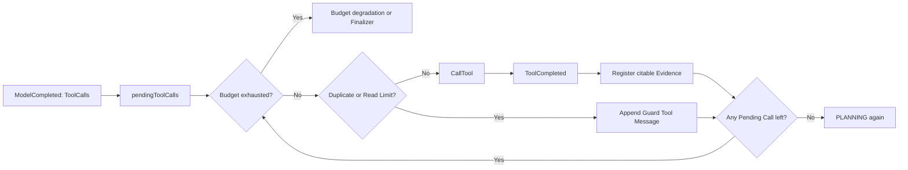
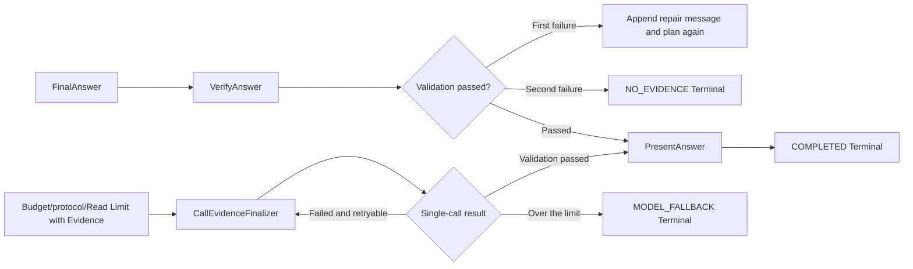
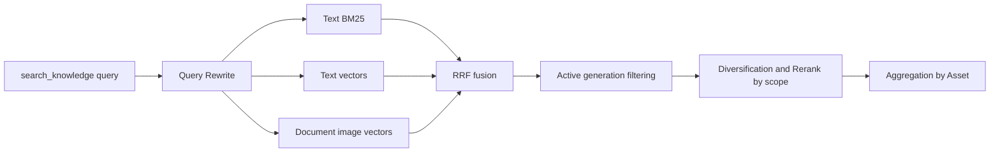

# Agent RAG implementation notes

This document records the current Agent RAG execution path, state, limits, and failure semantics in `anchr-app`. It reflects the source code, runtime configuration, and database migrations; it does not describe planned capabilities.

## 1. Execution path

A message request executes either in the Agent path or in the traditional path:



Key constraints:

- The model decides tool calls; permissions, budget, evidence, citations, and terminal states are validated by the backend.
- The traditional path only produces `CHAT` and `KB_QUERY`: retrieval is skipped only for plainly ordinary conversation, and every other valid request enters RAG by default.
- The Agent can only cite Segments registered for the current Run.
- Elasticsearch may hold multiple generations at once, and queries only accept the active generation of an asset.
- An SSE disconnect does not cancel execution; the Turn is still persisted, and the client recovers state through the Run, Task, or message APIs.
- Document summarization uses an asynchronous Task and does not read full text inside the synchronous Run.

## 2. API and request scope

### 2.1 API

| Scenario | API | Behavior |
| --- | --- | --- |
| Synchronous Q&A | `POST /api/v1/conversations/{sessionId}/messages` | Returns JSON after execution completes and the Turn is saved |
| Message SSE | `POST /api/v1/conversations/{sessionId}/messages/stream` | Sends process events and safe model answer deltas in real time; the terminal state is reconciled with the complete answer |
| Query a Run | `GET /api/v1/agent/runs/{runId}/activity` | Returns the persisted Run, Steps, tools, tokens, and durations |
| Query recoverable Runs | `GET /api/v1/agent/runs/recoverable?limit=10` | Returns at most `limit` records; default 10, maximum 20, with active Runs first, and includes Runs started within the last 10 minutes |
| Query a runtime snapshot | `GET /api/v1/agent/runs/{runId}/runtime-snapshot?afterVersion=0` | Returns the latest runtime state in Redis only when the snapshot version is newer |
| Cancel a Run | `POST /api/v1/agent/runs/{runId}/cancel` | Requests cancellation of a synchronous Agent Run that is still `RUNNING` |
| Query an async task | `GET /api/v1/agent/tasks/{taskId}` | Returns task status, progress, answer, and citations |
| Subscribe to an async task | `GET /api/v1/agent/tasks/{taskId}/stream` | Sends task progress and the terminal answer over SSE |
| Cancel an async task | `POST /api/v1/agent/tasks/{taskId}/cancel` | Cancels a `PENDING/RUNNING` task and updates the Turn and Run |

Message fields:

| Field | Purpose |
| --- | --- |
| `query` | The user question, up to 1000 characters |
| `kbIds` | The knowledge base scope for this request |
| `assetIdList` | The explicit document scope for this request; when non-empty, document tools must not go beyond it |
| `limit` | Number of retrieval results, range 1–200 |
| `answerMode` | `STRICT`, `SUMMARY`, or `EXPLORE` |
| `preferredModalities` | `TEXT`, `IMAGE`, or `MIXED` |
| `agentEnabled` | Whether the client requests the use of the Agent |

### 2.2 Component responsibilities

- `ConversationServiceImpl` is the stable application service facade.
- `ConversationMessageUseCase` loads the session, normalizes the request scope, generates `turnId/runId`, invokes the orchestrator, saves the Turn/Task in a transaction, triggers async tasks after commit, and finalizes the Run after the Turn is saved.
- `ConversationMessageOrchestrator` is only responsible for choosing the Agent path or the traditional path.
- `ConversationMessageStreamAdapter` adapts the same message use case to SSE and is not responsible for business orchestration.

### 2.3 Scope handling

Processing order:

1. Load the session that is not soft-deleted; if it does not exist, return `CONVERSATION_SESSION_NOT_FOUND`.
2. When the request has no `kbIds` and the session already has a `kbScope`, inherit the session scope.
3. Otherwise, use `ConversationKnowledgeAcl` to narrow `kbIds` down to the currently visible active knowledge bases.
4. `answerMode` defaults to `STRICT`.
5. When `preferredModalities` is empty, it defaults to `MIXED`.
6. `assetIdList` is the explicit document scope for this message and is recorded verbatim on the Turn; the Agent also resolves these IDs server-side into currently valid, accessible assets.

#### Known gap: Session Asset Scope

The database, domain objects, and session DTO already contain `asset_scope/assetIdList`, but the business flow is not wired up yet:

- `ConversationSessionUseCase.create` only saves `kbScope` and does not write the `assetIdList` of the create request into the session.
- `ConversationMessageUseCase.applyConversationScope` only inherits the session `kbScope` and does not inherit the session `assetScope`.
- The scope in effect is currently determined by the message request's `assetIdList`; session-level Asset Scope is not yet available.
## 3. Agent and traditional paths

The Agent is entered only when both of the following conditions hold at the same time:

```text
request.agentEnabled == true
runtime configuration AGENT.enabled == true
```

`AgentWorkflow` is a required dependency of the orchestrator. A missing Bean is a wiring error and will not silently fall back to the traditional flow at runtime.

The non-Agent path runs the Intent Router first:

- `CHAT`: ordinary chat generation, no knowledge retrieval.
- `KB_QUERY`: every other valid request enters the traditional RAG Pipeline by default, including uncertain cases, cases missing a task object, and classification failures.

Standalone greetings, thanks, and farewells that hit exact rules match `CHAT`; greetings, short sentences, and follow-up questions mixed with a knowledge task are left to the model to judge together with the recent conversation.
The model may only return `CHAT|KB_QUERY` and must not infer before retrieval that the knowledge base has no material. When the model's confidence for `CHAT` is below 0.8, the case is treated as uncertain and falls back to `KB_QUERY`; clearly ordinary conversation such as capability introductions may return a high-confidence `CHAT`.
Timeouts, empty output, invalid JSON, unknown categories, missing confidence, or the legacy value `OTHER` all fall back to `KB_QUERY`, recording `source=FALLBACK`, `fallback=true`, and the reason. When intent routing is disabled, the request still goes directly to `KB_QUERY`.
The `OTHER` enum is retained for reading historical records, and new routing no longer produces that value; when the orchestrator receives a legacy `OTHER` result, it also converts it to `KB_QUERY` before executing and saving. API validation for empty input, invalid parameters, and permissions is unchanged.
The routing completion log `Conversation intent routing completed` records sessionId, type, source, fallback, confidence, and reason. Default retrieval may increase the latency of ambiguous requests; it does not mean the system can perform arbitrary tasks. Answers are based only on evidence, and when the object is missing the system should ask for more information rather than guessing or pretending to perform external operations.

The Agent path does not run the Intent Router. When the Agent hits an unexpected exception and
`AGENT.fallbackToTraditional=true`, the orchestrator routes again and executes the traditional flow, recording the execution mode as `AGENT_FALLBACK`.
`AgentWorkflowImpl` wraps exceptions that are not consumed by the state machine during initialization and runtime uniformly as
`AgentWorkflowException`, so that Repository, configuration loading, or history reading exceptions do not escape as bare exceptions.
Note that initialization happens before `RunStarted`; if initialization fails, the Agent Trace has not been created yet,
so only the orchestrator can fall back to the traditional flow, and a non-existent Agent Run cannot be updated to `FAILED`.

## 4. Run context and budget

### 4.1 Immutable Run State

`AgentState` is the immutable snapshot of a single synchronous Run and contains:

- `runId`, `turnId`, `sessionId`, `userId`, and the KB/Asset scope of this run.
- The model message list.
- The Evidence Registry for the current Run, deduplicated by `segmentId`.
- Executed Tool Call Keys, used to reject repeated calls.
- The execution count of each tool.
- The number of model steps, the number of tool calls, and the Prompt/Completion tokens.
- The number of consecutive protocol errors, the number of final answer validation errors, the Trace order, and the current step.
- The queue of tools pending execution, the number of Finalizer attempts, and the Finalizer repair context.

Messages, evidence, executed tool keys, tool counts, and the queue of pending tools are copied into read-only collections when the snapshot is constructed. Evidence does not merely copy the Map: `ConversationRetrievalCandidate` as well as the nested Anchor, Bbox, Explain, and hit-source lists are all defensively copied; a blank `segmentId` never enters the Registry. Every state transition returns a new snapshot, and old snapshots never change with later tool results, Evidence registration, external Candidate changes, or counter updates.

Phase changes all go through the runtime validation of `AgentWorkflowPhase.canTransitionTo`. An illegal transition throws immediately; the Runner's current event order must not be relied on to implicitly guarantee a legal state.

`AgentBudget` only computes exhaustion, remaining time, and the per-call limit from the `now` supplied by the caller. The state machine does not read the system clock, so the same `State + Event` yields the same Transition.

`AgentRequestContextResolver` reads valid resource information from the server again and locks the context to a scope that cannot be widened; the context displays at most 50 KB metadata entries and 20 Asset metadata entries.

### 4.2 Model context

The model context contains:

1. The system prompt and the answer-mode constraints.
2. At most the 10 most recent Turns.
3. At most 1200 characters per historical question and answer.
4. At most 12000 characters in total for history.
5. Removal of old `[1]` and `[1-1]` citations from historical answers, so that numbering from an old Run is not treated as current evidence.
6. The current server resource context and the user question.

### 4.3 Default budget

| Budget | Default value |
| --- | ---: |
| Maximum model steps | 12 |
| Maximum tool calls | 8 |
| Total Run time limit | 90 seconds |
| Per model call time limit | 30 seconds, also bounded by the remaining Run time |

Handling after the budget is exhausted:

- With existing evidence and at least 500ms remaining: enter the Evidence Finalizer.
- With no evidence or no time left: return a local clarification, `AnswerStatus=NO_EVIDENCE`, and the Run ends as `DEGRADED` with the reason `agent_budget_exhausted`.

### 4.4 Synchronous Agent state loop

`AgentWorkflowImpl` only runs a fixed event loop and no longer parses protocols, executes tools, registers Evidence, decides retries, or constructs business terminal states:



Each Transition produces at most one external Command. When the model returns several Tool Calls at once, the state machine stores them in `pendingToolCalls` and emits only the first `CallTool`. The Runner checks business cancellation against `AgentRunCancellationRegistry` before and after the Command; when scheduling each pending tool, the state machine first checks the budget, then repeated calls and the `read_document` limit. When the budget is already exhausted, it goes straight to budget degradation or the Finalizer and no longer produces extra duplicate/read-limit Signals, Trace entries, or reason strings.

Before applying `nextState` and publishing the Terminal Signal, a non-cancellation Terminal must atomically claim the terminal state through the Cancellation Registry. If the cancellation request is accepted first, the Runner discards the not-yet-published Completion/Failure Transition and sends `CancellationRequested` from the original non-terminal State; if the Terminal claims successfully first, the Registry removes the running handle and a later-arriving cancellation returns a miss. This closes the window where "the post-effect check has already passed but a cancellation arrives before the Terminal commits", and the Presentation fallback cannot override an already-accepted cancellation.

#### Phase one: initialization and planning



The Initializer freezes the runtime configuration and the deadline, consumes the history character budget newest-first, then restores chronological order; it also cleans up old citation numbering, parses historical Citation metadata, and constructs the server-side Request Context.
Initialization sits inside the Workflow's unified `try/finally` boundary. An initialization failure is wrapped as
`AgentWorkflowException`; the `finally` block only deregisters after a cancellation handle has been registered successfully, so that failure paths do not leave a dangling registration.

#### Phase two: tool execution and evidence registration



The duplicate and read-limit guards do not increase the actual tool call count. A legal tool increments `toolCallCount` before `CallTool` is emitted; the tool completion Event carries the compacted model messages, Evidence, Trace summary, and duration.

#### Phase three: validation, Finalizer, and Presentation



The Finalizer calls the model only once per Command; the Transition Engine decides the rule of at most two attempts. Presentation performs at most one streamed model call per Command. When streaming fails or output validation fails, the Run completes with the already-validated draft and is not marked as failed.
An answer validator exception is first converted into an `AnswerVerificationFailed` Event, and the state machine then produces the
`FAILED` Terminal; the Workflow ultimately throws `AgentWorkflowException`, and the upper layer decides whether to switch to the traditional flow.
Presentation allows only a candidate that passes validation to trigger `answer_reset`. If the candidate contains internal
`{{segment:...}}`, a raw `segmentId`, or an illegal visible citation, then regardless of whether the generation port produced deltas,
that candidate is not sent to the client over SSE; when provisional deltas exist, it resets to the already-validated draft, and when no deltas exist, it completes with the draft directly.

#### Signal and side-effect boundaries

| Object | Responsibility |
| --- | --- |
| `AgentEvent` | Carries external call results, completion time, Usage, and semantic decisions |
| `AgentCommand` | Describes a single Model, Tool, Verify, Finalizer, or Presentation call |
| `AgentSignal` | Fixes the sequence numbers, attempts, counters, details, and failure cause needed for Progress, Trace, Metrics, and operational logs |
| `AgentRunObserver` | Persists the Trace, sends Progress, and records Metrics; failures are handled best-effort |
| `AgentTerminal` | Holds the answer status, degradation reason, Citation, Deferred Task, Run status, and exception cause |

`AgentTransitionEngine` has no Spring annotations and does not depend on Repository, Clock, Metrics, or Listener. `AgentEffectRunner` only routes Commands to `AgentModelEffect`, `AgentToolEffect`, and `AgentCompletionEffect`, and all results are first turned into Events. `AgentActionProtocol` only parses native/JSON output into semantic decisions and no longer holds error counters or Metrics.

`AgentSignal.Progress.details` and the Trace input/output summary use immutable snapshots that preserve the ability to hold null values, rather than `Map.copyOf`. As a result, a null in an observable field does not trigger an NPE inside a Transition, and the Observer cannot modify State in the other direction. Answer validation rejections use the `AnswerValidationRejected` Signal; effect exceptions from the Finalizer or Presentation use the `EffectFailure` Signal carrying the original cause, and the Observer is responsible for logging the full exception stack.

The synchronous state machine does not take over `AgentTaskProcessor`. `summarize_documents` still ends the synchronous Run with `DeferredTask/WAITING_TASK`, and subsequent asynchronous processing continues to use the existing Task status, Lease, Trace Order, and recovery protocol.
## 5. Model protocol

### 5.1 Tool calling modes

| Mode | Behavior |
| --- | --- |
| `NATIVE` | Accepts only OpenAI-compatible native `tools/tool_calls` |
| `JSON` | Does not send native tool definitions and requires the model to output strict action JSON |
| `AUTO` | Prefers native tools; falls back to JSON mode when the native request fails and time remains |

Default settings for native mode:

- `tool_choice=required`, configurable to `auto`.
- `parallelToolCalls=false`.
- Spring AI automatic tool execution is disabled; the business state machine executes tools uniformly.
- Temperature `0.2`, maximum output tokens `1500`.

JSON mode accepts only the following two structures:

```json
{"action":"call_tools","toolCalls":[{"id":"call_1","name":"tool name","arguments":{}}]}
```

```json
{"action":"final","answerType":"CHAT|CLARIFICATION|KNOWLEDGE|NO_EVIDENCE","answer":"final answer","citedSegmentIds":[]}
```

A normal answer ends through `deliver_answer`; the strict JSON `final` form is for models that do not support native tool calling.

### 5.2 Protocol errors

Ordinary Markdown or natural language is not a legal action. Handling rules:

| Consecutive errors | Evidence in the Run | Handling |
| --- | --- | --- |
| First | Any | Inject a repair prompt and retry |
| Second | Yes | Enter the Evidence Finalizer |
| Second | No | Return a local safe answer |

A legal Tool Call resets the consecutive protocol error count to zero. On the second error, when the run cannot be closed out with evidence, the system returns
`AnswerStatus=MODEL_FALLBACK`; after the Turn is saved the Run is `DEGRADED`, with a reason starting with
`agent_protocol_error:`.

## 6. Agent tools

| Tool | Purpose | Key inputs | Behavior | Registers evidence |
| --- | --- | --- | --- | --- |
| `find_documents` | When the target document is uncertain | `query`, `limit<=10` | Returns documents, the real `assetId`, and matching chunks | Yes |
| `search_knowledge` | For facts, rules, processes, or related content | `query`, optional `assetIds`, `limit<=10`, modality | Retrieval after Query Rewrite | Yes |
| `read_document` | To read one located document sequentially | `assetId`, `cursor`, `limit<=20` | Paged reading in original order | Yes |
| `summarize_documents` | To summarize, analyze, or compare 1–3 documents | `assetIds`, `instruction`, `language` | Creates a `DOCUMENT_SUMMARY` async task | No, the task reads full-text evidence itself |
| `deliver_answer` | To submit the final answer | Four `answerType` values, body, citation IDs | Enters final answer validation | No |

### 6.1 Arguments, permissions, and repeated calls

`AgentToolExecutor` handles uniformly:

1. Tool registration check, otherwise `UNKNOWN_TOOL`.
2. JSON argument deserialization and Jakarta Validation, otherwise `INVALID_ARGUMENTS`.
3. Business exceptions mapped to stable error codes.
4. Security exceptions mapped to `PERMISSION_DENIED`.
5. Unknown exceptions mapped to `TOOL_EXECUTION_FAILED`.

Tool errors are returned to the model as a Tool Message and do not automatically end the Run.

`AgentScopeGuard` performs server-side scope validation for document tools:

1. First treat the input as an `assetId` and look it up within the authorized KBs.
2. If it is not an ID, match exactly by full file name or title.
3. Multiple documents with the same name return `AMBIGUOUS_DOCUMENT`.
4. Not found returns `DOCUMENT_NOT_FOUND`.
5. When this request has an `assetIdList`, out-of-scope access returns `PERMISSION_DENIED`.

`find_documents.documents[].assetId` is the input for subsequent document tools; `matchedSegmentId` is not an `assetId`.

Tool Call deduplication rules:

- When `call.id` is present, use the ID directly.
- When there is no ID, use `toolName + arguments`.
- A repeated call returns `DUPLICATE_TOOL_CALL` and is not executed again.

### 6.2 `read_document` limits

- The default and maximum page size are both 20; a value that is too small is raised to 10.
- A single response returns at most about 20000 characters of body text in total.
- `nextCursor` uses Base64 URL-safe encoding.
- Once the same Run has evidence, `read_document` is actually executed at most twice; the third attempt returns `READ_LIMIT_REACHED` and then goes directly to the Evidence Finalizer.
- When a full read-through is needed, `summarize_documents` should be used instead.

## 7. RAG retrieval sub-flow

`search_knowledge` performs conversation-aware Query Rewrite first; `find_documents` locates documents by combining asset metadata and retrieval results. Both ultimately enter the Search context through `ConversationRetrievalAcl`.



### 7.1 Query Rewrite

- Uses at most the 5 most recent Turns.
- Historical context is at most 6000 characters, with each field at most 1200 characters.
- The current question is at most 2000 characters.
- The model must output strict JSON.
- On timeout, exception, or malformed output, the original question is used.

### 7.2 Three-way recall, generation gate, and Rerank

Execution order in `RetrievalQueryServiceImpl`:

1. Resolve the currently visible KBs through `SearchKnowledgeAcl` and apply KB/Asset/type filters.
2. Generate an Embedding once for the query.
3. Execute full-text/keyword recall, text vector recall, and document image vector recall in sequence; the current implementation does not schedule these three calls in parallel.
4. Perform RRF fusion by `segmentId`.
5. Query each asset's currently active `indexGeneration` and discard candidates whose generation does not match.
6. With multiple assets or when no single asset is specified, first diversify candidates by `assetId + segmentType`, keeping at most 3 per group.
7. Run Rerank on the competitive window.
8. When a single asset is explicitly specified, diversification is deferred until after Rerank so that same-document chunks that could still be recovered are not dropped before Rerank.
9. Aggregate Top Chunks by Asset.

RRF:

```text
RRF(segment) = Σ 1 / (rankConstant + rankIndex + 1)
```

Rerank defaults:

- Window 40, minimum 20, maximum 80.
- Normalized retrieval score weight `0.6`, Rerank score weight `0.4`.
- On Rerank exception or empty result, the RRF order is kept.

Before a new generation is activated, queries read the old generation. After activation, even if Elasticsearch temporarily retains both old and new Segments, only the new generation passes the filter.
## 8. Evidence finalization

The Evidence Finalizer uses the evidence already registered for the current Run to generate a constrained answer and no longer opens tool calling.

Trigger conditions:

- The Agent budget is exhausted and evidence already exists.
- The second consecutive protocol error occurs and evidence already exists.
- After evidence exists, a third `read_document` execution is attempted.

Handling:

1. Select at most 12 pieces of evidence with a non-empty `segmentId` from the current Run Evidence Registry; candidates lacking a citable ID do not count toward the selection quota.
2. The evidence input is at most about 24000 characters.
3. Generate strict `KNOWLEDGE|NO_EVIDENCE` JSON through `ConversationGenerationPort`.
4. Attempt at most 2 times while the remaining time allows, and each attempt is still bounded by the Agent's per-model-call time limit.
5. On success, continue through the same citation validation as `deliver_answer`.

Strict JSON is the generation protocol. When the JSON lacks `answerType` but the body contains legal
`{{segment:...}}` Markers, the parser may infer `KNOWLEDGE`, but it must still provide `citedSegmentIds`
consistent with the Markers in order to pass Evidence validation. Non-JSON text also keeps its body and an attempt is made to infer the type; because it has no separate `citedSegmentIds` field, it is currently rejected by the validator with `INVALID_CITATION` and triggers the next Finalizer attempt when the budget and attempt count allow, rather than being accepted directly as a legal answer.
Text with no Markers whose Answer Type cannot be determined is likewise handled as invalid Finalizer output.

When the Finalizer is unavailable or both attempts fail:

- Return `AnswerStatus=MODEL_FALLBACK`.
- The reasons are `agent_evidence_finalization_unavailable` or `agent_evidence_finalization_failed` respectively.
- After the Turn is saved, the Run terminal state is `DEGRADED`.

## 9. Answers and citations

### 9.1 Answer Type

| `answerType` | Rules |
| --- | --- |
| `CHAT` | No evidence needed; citation IDs and Segment Markers are forbidden |
| `CLARIFICATION` | No evidence needed; citations are forbidden |
| `KNOWLEDGE` | Must have current Run evidence, legal citation IDs, and body Markers |
| `NO_EVIDENCE` | Citations are forbidden; the backend replaces the body with the unified safe no-evidence text according to the answer mode |

`NO_EVIDENCE` is a business result: `AnswerStatus=NO_EVIDENCE`, and after the Turn is saved the Run is `COMPLETED`.

### 9.2 Evidence Registry and KNOWLEDGE validation

Evidence within a Run is registered with the following structure:

```text
segmentId -> ConversationRetrievalCandidate
```

Only Segments returned and registered by `find_documents`, `search_knowledge`, and `read_document` in the current turn can be cited. Citations from historical answers, IDs fabricated by the model, and evidence from other Runs are all invalid.

KNOWLEDGE validation checks in order whether the current Run has evidence, whether the citation IDs belong to the current turn, and whether the body contains legal Markers. If any condition is not satisfied, the answer enters repair.

Internal Marker:

```text
conclusion content {{segment:realSegmentID}}
```

Validation and rendering steps:

1. When the model writes `[number]` or `[number-number]` on its own, the validator rejects the answer with `UNTRUSTED_VISIBLE_CITATION`; the first failure returns the answer to the model for repair rather than deleting the citation and accepting it.
2. The renderer recognizes only Markers in the current Evidence Registry.
3. It assigns document and Segment indices in order of first appearance in the body.
4. It renders them as `[1-1]`, `[1-2]`, `[2-1]`.
5. It produces Citations containing `kbId`, `assetId`, `segmentId`, page number, anchor, and hit reason.

On the first validation failure, the error is returned to the model for repair; on a second failure, a safe `NO_EVIDENCE` is returned. The backend has produced a legal terminal answer, so after the Turn is saved the Run is `COMPLETED`.

## 10. Asynchronous document summarization

`summarize_documents` returns an `AgentDeferredTask`. The synchronous request first saves a PROCESSING placeholder Turn and a PENDING Task, and triggers background processing after the transaction commits.

Task status and processing stage are two independent sets of states.

Task status:

```text
PENDING -> RUNNING -> SUCCEEDED | FAILED | CANCELLED
              |
              +-> PENDING (waiting to retry)
```

`currentStage`:

```text
QUEUED -> READING -> MAP_SUMMARY -> REDUCE_SUMMARY -> FINALIZING -> COMPLETED
any execution stage -> RETRY_WAIT -> READING (re-execute)
any active stage -> FAILED | CANCELLED
```

When a retryable failure occurs, the Task status goes back to `PENDING` and `currentStage` is set to `RETRY_WAIT`; after it is claimed again, the Task status becomes `RUNNING` once more. On successful completion, the Task status is `SUCCEEDED` and `currentStage` is `COMPLETED`.

### 10.1 Default limits

| Limit | Default value |
| --- | ---: |
| Number of documents | 1–3 |
| Maximum Segments | 500 |
| Maximum body characters | 500000 |
| Map/Reduce batch characters | 12000 |
| Total task time limit | 10 minutes |
| Per summarization model call time limit | 90 seconds |
| Lease | 2 minutes |
| Maximum retries | 2 |
| Polling interval | 5 seconds |

### 10.2 Processing stages

1. `READING`: read the full text in the document's original Segment order.
2. `MAP_SUMMARY`: generate partial summaries in batches of about 12000 characters and preserve Markers.
3. `REDUCE_SUMMARY`: merge hierarchically until a single draft is formed.
4. `FINALIZING`: perform one final model compression and send safe visible body deltas to the task SSE.
5. The backend then uses `AgentCitationPolicy.compactMarkers` to converge citations deterministically: at most 10 distinct citations, 12 Markers, and at most 3 Markers per segment.

Tasks use Lease and Owner to guarantee a single executor per task; a RUNNING task with an expired Lease can be claimed again. The delay for a retryable failure is `30 seconds × current attempt`, capped at 120 seconds.

The task SSE currently sends:

- `task`: status, progress, and stage.
- `delta`: safe visible deltas only in the Final stage; intermediate Map/Reduce results are not sent.
- `answer_reset`: may clear old provisional output with empty content when the task starts, retries, or fails; on success it sends the canonical complete answer after the Task and Turn are persisted.
- `citations`: the final Citation list.
- `done`: the task has ended.

The Final model uses temporary citation tokens that contain no Segment ID; the delta renderer buffers incomplete tokens and Markdown fences and only sends them after conversion into visible citations. The complete answer goes through citation scope validation and deterministic density convergence; if the density check is still abnormal after convergence, the current implementation logs a warning but does not abort the task on its own. After the Task and Turn transactions are saved successfully, the flow completes in the order `answer_reset → citations → done`.

## 11. Persistence and state

### 11.1 Tables

| Table | Purpose |
| --- | --- |
| `conversation_session` | Session and scope fields; currently only the default KB Scope is actually written and inherited |
| `conversation_turn` | Question, answer, KB/Asset Scope for this request, citations, execution mode, and Run/Task associations |
| `agent_run` | Run status, steps, tools, tokens, durations, degradation, and errors |
| `agent_step` | Model decisions, tool results, and async task stages |
| `agent_task` | Async summarization task, Lease, progress, retries, answer, and errors |

### 11.2 Run terminal states

A synchronous Agent first produces the result and then saves the Turn:

```text
RUNNING
  -> AWAITING_TURN
  -> COMPLETED | DEGRADED | FALLBACK
```

Specific rules:

- A normal answer, the model declaring `NO_EVIDENCE`, or a safe answer after the second answer validation: `COMPLETED`.
- Budget exhaustion, protocol degradation, or the Evidence Finalizer being unavailable or failing: `DEGRADED`.
- Successfully switching to the traditional path after an unexpected Agent exception: `FALLBACK`.
- Turn save failure: `FAILED`, with error code `turn_persistence_failed`.

Async tasks:

```text
RUNNING -> WAITING_TASK -> COMPLETED | FAILED | CANCELLED
```

The full set of Run states is:

```text
RUNNING
AWAITING_TURN
WAITING_TASK
COMPLETED
CANCELLED
FAILED
DEGRADED
FALLBACK
```

When displayed by the API, `DEGRADED` maps to `AGENT_DEGRADED` and `FALLBACK` maps to `AGENT_FALLBACK`.

Run terminal-state writes use a conditional update with an expected state rather than an unconditional overwrite: the synchronous Workflow can only commit its result from
`RUNNING`, the Finalizer after the Turn is saved can only commit a terminal state from `AWAITING_TURN`,
and async Task completion, failure, or cancellation can only commit a terminal state from `WAITING_TASK`. A late completion, failure, or cancellation
cannot overwrite another terminal state that has already been persisted.
## 12. SSE and recovery

### 12.1 Message SSE

Message SSE enables the answer-streaming capability. CHAT forwards model deltas directly; traditional RAG sends a provisional body through the incremental JSON decoder and reconciles it after final validation; Agent-cited answers send only text that has already been validated. When the final answer differs from the provisional content, `answer_reset` is used to reconcile.

Typical events:

| SSE Event | Typical content |
| --- | --- |
| `trace` | `agent_thinking/run_started` |
| `trace` | `agent_thinking/decision_started|decision_completed|decision_failed` |
| `trace` | `tool_call/started` |
| `trace` | `tool_result/completed|failed|duplicate_rejected|read_limit_reached|answer_repair_required` |
| `trace` | `agent_thinking/protocol_retry|protocol_fallback|protocol_finalizing_evidence` |
| `trace` | `agent_thinking/evidence_finalization_started|evidence_finalized|evidence_finalization_failed` |
| `trace` | `task_queued/completed` |
| `delta` | A safe answer delta with `answerId/revision/sequence` |
| `answer_reset` | Canonical complete-answer reconciliation |
| `citations` | The final Citation list |
| `done` | Turn, Run, status, mode, and Task metadata |
| `error` | A business error code or an internal error |

### 12.2 Client disconnect

When SSE disconnects or the 120-second transport timeout expires:

1. The Adapter only marks the connection as disconnected.
2. The backend continues executing the message use case, saves the Turn, and publishes the final runtime snapshot when a `runId` exists.
3. Because the connection is already disconnected, no further answers are sent to that Emitter.
4. An SSE disconnect does not automatically write a cancellation marker and does not change the Run to `CANCELLED`.

Cancellation is only triggered after the Run/Task cancellation API or session-deletion cleanup registers it in `AgentRunCancellationRegistry`. Registering a cancellation interrupts the current executing thread so that blocking calls such as model and tool calls exit as soon as possible; but the thread's interrupt flag itself is not the basis for business cancellation. If a framework timeout, an external interrupt, or a leftover thread-pool interrupt has no corresponding Registry record, execution must continue or fail according to the actual effect result and must not be disguised as `CANCELLED/query cancelled`.

Cancellation registration and non-cancellation Terminals use the same Registry critical section to decide ordering: an already-accepted cancellation takes precedence over a not-yet-committed `COMPLETED`, `DEGRADED`, or `FAILED` Terminal; a Terminal that has already been atomically claimed no longer accepts a late cancellation.

The synchronous Workflow clears the current thread's interrupt flag uniformly at all exits, including normal completion, business cancellation, the `FAILED` Terminal, initialization exceptions, and Runner fallback exceptions, so that thread-pool reuse does not carry a previous round's interruption into the next Run.

### 12.3 Sources of state

- Conversation, Agent Run, Agent Step, and Agent Task in MySQL are the authoritative data.
- The Redis Runtime Snapshot is a best-effort cache; read and write failures must not affect the main workflow.
- Snapshots use a monotonically increasing `version`, and clients can use `afterVersion` to avoid repeatedly fetching an old snapshot.
- The default TTL is 35 minutes; the actual TTL is the larger of the configured value and "total task time limit × maximum attempt count + 5 minutes".
- The recoverable list returns at most 20 records, prioritizing the active states `RUNNING/WAITING_TASK/AWAITING_TURN`, and includes terminal Runs started within the last 10 minutes.
- The Answer Event Broker shared by Conversation and Task only covers a single JVM. The current system supports only a single App instance; Task/Turn polling and Runtime Snapshot are for recovery after client disconnection or process restart, not a consistency scheme for multi-instance deployment.

## 13. Failures and degradation

| Scenario | Local handling | Final result |
| --- | --- | --- |
| Query Rewrite failure | Use the original Query | Continue retrieval |
| Empty Embedding | Throw a business exception | Enter the upper-layer exception path |
| Rerank failure or empty result | Keep the RRF order | Continue answering |
| Tool argument or already-normalized execution error | `AgentToolResult.failure` is returned to the model and the existing FAILED Trace/Progress is kept | The model may retry after repairing |
| Tool Effect boundary exception | Convert to `ToolFailed` keeping the cause; no new Step, Progress, or step latency | `FAILED` Terminal, take the traditional path when configuration allows |
| Repeated tool call | `DUPLICATE_TOOL_CALL` | Not executed again |
| First occurrence of no legal Agent action | Inject a protocol repair message | Retry the model |
| Second occurrence of no legal action with existing evidence | Evidence Finalizer | On success complete normally, on failure `MODEL_FALLBACK/DEGRADED` |
| Second occurrence of no legal action with no evidence | Local safe answer | `MODEL_FALLBACK/DEGRADED` |
| First final answer validation failure | Return the error to the model | Repair the answer |
| Second final answer validation failure | Local safe no-evidence answer | `NO_EVIDENCE/COMPLETED` |
| Budget exhausted with existing evidence | Evidence Finalizer | On failure `MODEL_FALLBACK/DEGRADED` |
| Budget exhausted with no evidence | Local clarification | `NO_EVIDENCE/DEGRADED` |
| Agent initialization failure | Wrapped as `AgentWorkflowException`; no Agent Trace exists at this point | Take the traditional path when configuration allows; the execution mode of the Turn/response is `AGENT_FALLBACK`; because there is no `agent_run` record, there is no Run that could be updated to `FALLBACK` |
| Answer Verifier exception | Converted to `AnswerVerificationFailed`, and the state machine produces the `FAILED` Terminal | The Workflow throws `AgentWorkflowException`; take the traditional path when configuration allows |
| Modeled Model or Verify exception | The Effect converts it into a failure Event, and the state machine produces the `FAILED` Terminal keeping the cause | The Workflow throws `AgentWorkflowException`; take the traditional path when configuration allows |
| Unexpected exception in the state loop itself | The Workflow uniformly wraps it as `AgentWorkflowException` and does not let a bare exception escape | Take the traditional path when configuration allows; a Run with an existing Trace is `FALLBACK` after the traditional answer is saved successfully, and when the Trace has not been created only the Turn/response records the `AGENT_FALLBACK` execution mode |
| Finalizer model exception | `FinalizerModelFailed` carries the cause; retry when the budget and attempt count allow | After exceeding the limit `MODEL_FALLBACK/DEGRADED` |
| Presentation exception or illegal output | Log the failure cause, discard the illegal candidate, and use the already-validated draft | The Run remains `COMPLETED`, and the client sees the same answer as the persisted one |
| Traditional RAG with no qualifying evidence | Fixed no-evidence template | `NO_EVIDENCE` |
| Malformed traditional answer or model failure | Return the generation-failure text by default; concatenate evidence when the legacy configuration is explicitly enabled | `GENERATION_FAILED` by default, legacy degradation gives `MODEL_FALLBACK` |
| Temporary async summarization failure | Delayed retry | `FAILED` after retries are exhausted |
| Permanent async summarization error | No retry | Task/Run `FAILED`, Turn updated to `MODEL_FALLBACK` |

## 14. Traditional RAG

When the Agent is disabled or the Agent degrades after an exception, `KB_QUERY` executes a fixed flow:

```text
TraditionalRagRewriteService (one model call, completes the full question using history and extracts a keyword array)
  -> Unified Retrieval (one call, internally text/vector recall, RRF, Rerank)
  -> Select complete evidence by retrieval rank (at most 5 assets, 3 chunks per asset, 10 chunks in total)
  -> Aggregate by asset; the evidence section including metadata is at most 24000 Unicode characters
  -> Result Card / Citation Mapping (card display does not constrain model evidence)
  -> Grounded Answer Generation (at most one model call)
  -> Citation validation and normalization, keeping only Citations actually used by the answer
  -> Generate citation reasons and save the Turn
```

The dedicated rewrite returns `resolvedQuestion`, `keywords`, `rewriteReason`, and `confidence`.
`resolvedQuestion` preserves all sub-questions, assumptions, negations, and necessary conditions and is passed to search as the complete `query`; `keywords` is an array of at most 8 keywords or phrases, each at most 100 characters, deduplicated after normalization, and is not multiple search requests.
`RewriteResult.rewrittenQuery` and the Turn's `rewritten_query` now store the complete retrieval question, consistent with `resolvedQuestion`.

Within a single search, the parts are used as follows:

- Text recall: use the keyword list when keywords exist; fall back to the complete query when it is empty.
- Vector recall: use the complete query to generate the embedding.
- Rerank: use the complete query to judge the relevance of candidates to the question.
- Answer generation: use the original question, the completed full question, and the evidence.

Dots or dollar separators in technical identifiers are replaced with spaces only when constructing traditional keywords, preserving each component; the complete query is unchanged and the ES analyzer configuration is not modified.
Production prompts define only general rules and do not hard-code business configuration names or preset answers. The model is prompted to extract 1–8 necessary terms but an empty array is accepted, using the existing keyword-free retrieval behavior.
Current text retrieval requires each phrase to match 70% of its tokens; when the number of keywords is no more than 2, all must match, and when it is more than 2, 70% of them must match; no separate keyword weight is configured.
Too many keywords may still reduce recall; the existing field weights, RRF/Rerank, and similarity thresholds are left unchanged.

There is no separate Planner, coverage-check model, or empty-recall follow-up search loop. One rewrite, one search, and at most one answer generation; the search still contains embedding and rerank calls internally.
When the rewrite model fails, the full question is invalid, the keywords are not an array, or a keyword entry is out of range, the full question and the query fall back to the user's original text and the keywords are empty; the model and search are not called again.

Compatibility boundary: `ConversationRetrievalOrchestrator` gains a keyword overload, and `ConversationRetrievalAcl` passes the keywords into `RetrievalHitQuery`; the latter gains an optional keyword list while keeping the old construction path, with old calls defaulting to an empty list.
The Hit query entry point of `RetrievalQueryServiceImpl` passes the keywords to the existing `searchInternal` without changing its matching logic. Ordinary Top-N search continues to use the original keyword entry point; the Agent continues to use the keyword-free overload, and the shared rewrite is unchanged; intent routing follows the binary classification default retrieval rule in section 3.
The `KB_QUERY` fallback after an Agent exception reuses this traditional flow, and only `CHAT` skips RAG.

Answer modes:

| Mode | Grounding count | Minimum evidence characters | Minimum Top Score | Speculation allowed |
| --- | ---: | ---: | ---: | --- |
| `STRICT` | 10 | 80 | 0.12 | No |
| `SUMMARY` | 10 | 60 | 0.10 | No |
| `EXPLORE` | 10 | 40 | 0.08 | Yes, and it must be explicitly labeled |

The Grounding counts above are overall caps and must simultaneously satisfy at most 5 assets, at most 3 chunks per asset, and a complete evidence section budget of 24000 Unicode characters.
`TraditionalRagEvidencePolicy` selects one by one by retrieval rank and does not reserve slots for low-ranked documents; it deduplicates first by segmentId and then by identical body text within the same asset. After selection it groups by asset, and within a group it sorts by chunkOrder first and then by complete page-number information, otherwise it keeps the retrieval order.
For the body it prefers content and uses snippet only when the original content is empty. A chunk that exceeds the budget is skipped entirely: it is not truncated, not replaced by a short snippet, neighboring chunks are not expanded, and the full text is not read; if none of the valid candidates fit, it returns `GENERATION_FAILED/evidence_budget_exceeded` and the answer model is not called.
24000 is the character budget of the evidence section including document and chunk metadata; it is not a token guarantee for the generation model and does not change automatically with ingestion configuration. The default ingestion setting is `chunkMaxTokens=1200`, and Markdown slicing usually targets about 2400 characters, but tables, structural blocks, and historical content can be longer. Before release, the capacity after reserving room for the question, prompt, and output must be verified with the actual model.

The SUMMARY prompt gives the overall conclusion first, then organizes the necessary points by question theme, and no longer limits them to at most 3; all traditional modes preserve conditions, exceptions, ordering, and document differences and do not claim that summarizing chunks amounts to reading the full text. The mode strategy shared by the Agent is unchanged.

The answer model still outputs `{"status":"ANSWERED|NO_EVIDENCE","answer":"body"}` and cites the input evidence with local numbering such as `[1]`; the backend maps them in order of first citation in the body to `[1-1]`, `[1-2]` (document number and chunk number within the document), and a repeated chunk keeps its number and may appear repeatedly. Only chunks that are actually cited are kept, illegal numbers are removed, and when there is no valid number at all it is handled as a generation failure or by the existing legacy strategy.
It answers against the user's original question and the completed full question and must not treat the keyword array as the answering target.
When some parts of a question have evidence, it answers the confirmed parts and clearly states that the other parts cannot be confirmed; when the evidence cannot support any substantive answer, the whole question returns `NO_EVIDENCE`.
The existing validation of evidence character count, Top Score, citation scope, and citation existence remains in effect. Semantic completeness is guided through the prompt and must be reviewed against the evidence; there is no separate coverage-decision model, and the system does not claim that the program can strictly prove an answer is complete.

Traditional SSE incrementally decodes JSON and converts citations with the same mapping rules; unclosed numeric citations are buffered and only the provisional body is sent; when final citation or format validation changes the answer, it is reconciled through `answer_reset`.
`CONVERSATION.legacyEvidenceFallbackEnabled` defaults to `false`. On model failure or malformed output it returns `GENERATION_FAILED`; when this configuration is explicitly enabled, the original evidence-concatenation degradation is used, with status `MODEL_FALLBACK`.

The `retrieval_trace` JSON stores `resolvedQuestion`, `searchQuery` (the complete question), and `keywords`, and no longer writes Planner/coverage information; the database tables and external request fields are unchanged.
Traditional citations continue to use `assetCitationIndex/segmentCitationIndex`, exposed as `citationIndex` and `chunks[].segmentIndex/citationLabel`, consistently across synchronous, SSE, and historical replay; historical `[1]` values are neither migrated nor renumbered. Result cards show at most 5 documents, prioritizing evidence selected by the model, while the card hitCount still counts retrieval hits; the front-end citation area counts only actual citations.
Front-end traditional source cards scroll horizontally on a single line; the left and right buttons and edge hints appear only when there is overflow; multiple chunks are selected through a popover outside the scroll container, and the double-layer citation in the body locates the exact segment and must not fall back to the first chunk. Agent cards keep their original interaction.

The log `Traditional evidence selected` records the candidate count, the number of selected assets/segments, the exact character count, the budget, the number of exclusion reasons, the input segmentIds, and the selection duration; `Traditional answer references normalized` records the number of invalid numbers; `Traditional answer citations` records the final number mapping, status, failure reason, and generation duration. Body text is not repeated in INFO.
The log `Traditional retrieval started` records `originalQuery`, `resolvedQuestion`, `query`, `keywords`, and the scope and fallback state; `Traditional retrieval completed` records `query`, `keywords`, and the final result.
The underlying `kb search recall completed` records the complete `query`, the `keywords` actually passed in, and the recall count for each channel. For legacy Agent calls the keywords are empty.
Logs no longer use `searchQuery` to mark a condensed phrase; `Traditional RAG rewrite fallback` records the sessionId and the failure reason.
Planning traces already persisted on historical Turns are kept as they are.

## 15. Observability and security

### 15.1 Trace and metrics

Model steps record the model, `finishReason`, message count, tool plan, tokens, and duration. Tool steps record the tool name, Call ID, status, error code, evidence count, document count, Segment count, and pagination state.

The Observer also restores runtime operational logs: Run start/end, model decision completion, tool start/completion/failure, duplicate rejection, the `read_document` limit, protocol errors, and answer validation rejections all leave logs carrying `runId`, step/attempt, and the necessary summary. Finalizer and Presentation exceptions are passed through the `EffectFailure` Signal, and the logs record the phase, exception message, and full cause; the state machine itself does not write logs directly. Failures in sending Observer, Trace, Metrics, or Progress are still handled best-effort and do not change State or Terminal.

`agent.run.result` records only the non-`FAILED` business terminal states that occur normally, and does not add a `status=FAILED` series for a `FAILED` Terminal that throws `AgentWorkflowException`. When traditional degradation is off, when the Recorder actually commits `FAILED`, or when a Turn save failure causes the Finalizer to commit `FAILED`, use `agent.run.count{status=FAILED}` for the count; with traditional degradation enabled by default, a failing Workflow first converts the existing Run to `AWAITING_TURN`, and after the traditional answer is saved it is finally counted as `agent.run.count{status=FALLBACK}`. Model call failures continue to keep the original `MODEL_DECISION` failure Trace and `decision_failed` Progress; `AgentToolResult.failure` continues to keep the original tool failure Trace/Progress. Only exceptions thrown by the Tool Effect boundary itself end the Run directly and do not create an extra FAILED Step, so no `agent.step.latency{step=FAILED}` or empty-usage `agent.model.tokens` sample is added.

Async task stages no longer use the fixed Trace Order `101–106`. The Processor first locks the corresponding Run and, inside the transaction, assigns the order for the new stage as the current maximum `stepOrder + 1`; the same `taskId + attempt + stage` updates the existing Step, and different retry attempts produce independent Steps. The fixed `101–106` in existing old data can still be recognized and updated in place. The stage semantics are:

```text
READING -> MAP_SUMMARY -> REDUCE_SUMMARY -> FINALIZING
        -> RETRY_WAIT -> COMPLETED|FAILED|CANCELLED
```

Main Metrics:

- `agent.step.latency`
- `agent.model.tokens`
- `agent.run.count`
- `agent.steps`
- `agent.tool.calls`
- `agent.run.tokens`
- `agent.protocol.error`
- `agent.run.result`
- `agent.workflow.fallback.count`
- `conversation.retrieval.latency`
- `conversation.retrieval.topk`
- `kb.search.rerank.calls`
- `kb.search.rerank.fallback`
- `answer.generate.fallback.count`
- `no_evidence.answer.rate`

The Trace stores only response shape and summaries, not the complete model answer or chain of thought.

### 15.2 Security and reliability

1. User input, historical messages, document bodies, and tool results are all treated as untrusted data.
2. The model can only call registered tools and cannot widen KB/Asset permissions.
3. Document tools must pass server-side scope validation and must not trust IDs supplied by the model.
4. KNOWLEDGE can only cite the Evidence Registry of the current Run.
5. The backend rejects numeric citations fabricated by the model and renders only legal Segment Markers as visible citations.
6. Async tasks use Lease, Owner, and conditional updates to prevent duplicate claiming and duplicate writes; this is task concurrency protection and does not mean the whole application supports multi-instance deployment.
7. Before an Agent Run is created and before the Turn is saved, the session that has not been deleted is locked, avoiding a race between session deletion and Run/answer persistence.
8. The Run is locked when assigning Trace Order in the async stage; when the Run does not exist, the write is skipped, avoiding new orphan Steps.
9. Terminal-state updates for Run and Task validate the expected source state, preventing concurrent completion, cancellation, and late writes from overwriting each other.
10. Deleting a session cancels active Runs/Tasks and deletes the related Trace and Task records.
11. Redis snapshots do not participate in permission or business terminal-state decisions; MySQL remains the authoritative source.

## 16. Key configuration

The Agent's switch, tool mode, budget, timeouts, async retries, and most summarization limits use the
`AGENT` runtime configuration in Settings. The traditional evidence degradation of Conversation uses
`CONVERSATION.legacyEvidenceFallbackEnabled`. A synchronous Run reads and freezes the configuration at initialization;
an async Task re-reads the configuration each time it is claimed and begins an execution attempt, so later retries of the same Task may use updated configuration, but it does not change within a single attempt.

The document summarization count is still fixed at 1–3 by a code constant. Although the Settings Catalog contains
`AGENT.summaryMaxDocuments`, `AgentRuntimeSettings`, `SummarizeDocumentsTool`, and
`AgentTaskProcessor` all currently use the fixed value 3, so this configuration item does not yet actually control runtime behavior.

The async task Lease is fixed at 2 minutes and the Claim polling interval is fixed at 5 seconds; neither accepts external configuration.

## 17. Code index

| Component | File |
| --- | --- |
| Session message REST | `ConversationController.java` |
| Run REST | `AgentRunController.java` |
| Async task REST | `AgentTaskController.java` |
| Application service facade | `ConversationServiceImpl.java` |
| Message use case, scope normalization, and Turn saving | `ConversationMessageUseCase.java` |
| Message SSE Adapter | `ConversationMessageStreamAdapter.java` |
| Agent/traditional path orchestration | `ConversationMessageOrchestrator.java` |
| KB visibility scope ACL | `ConversationKnowledgeAcl.java` |
| Agent request context resolution | `AgentRequestContextResolver.java` |
| Agent synchronous runner | `AgentWorkflowImpl.java` |
| Pure state transition | `AgentTransitionEngine.java`, `AgentTransition.java` |
| Immutable Run state | `AgentState.java`, `AgentBudget.java` |
| Event, Command, Signal, and Terminal | `AgentEvent.java`, `AgentCommand.java`, `AgentSignal.java`, `AgentTerminal.java` |
| Run initialization | `AgentRunInitializer.java` |
| Effect routing and vertical boundary | `AgentEffectRunner.java`, `AgentModelEffect.java`, `AgentToolEffect.java`, `AgentCompletionEffect.java` |
| Progress, Trace, and Metrics Observer | `AgentRunObserver.java` |
| Model adaptation and Tool Choice | `SpringAiAgentModelAdapter.java` |
| Tool registration and execution | `AgentToolRegistry.java`, `AgentToolExecutor.java` |
| The five Agent tools | `application/agent/tool/` |
| Conversation/Search retrieval boundary | `ConversationRetrievalAcl.java` |
| Three-way retrieval, generation gate, and Rerank | `RetrievalQueryServiceImpl.java` |
| Conversational Query Rewrite | `QueryRewriteServiceImpl.java` |
| Evidence Finalizer and streaming Presentation Effect | `AgentCompletionEffect.java` |
| Agent citation rendering | `AgentCitationRenderer.java`, `AgentCitationIndexPlan.java` |
| Async summarization processing | `AgentTaskProcessor.java` |
| Async task SSE | `AgentTaskStreamService.java` |
| Runtime Snapshot | `AgentRuntimeSnapshotService.java` |
| Run query and recovery list | `AgentRunActivityService.java` |
| Run Trace and terminal state | `AgentTraceRecorder.java`, `AgentRunFinalizer.java` |
| Traditional RAG | `ConversationMessagePipeline.java`, `TraditionalRagRewriteService.java`, `AnswerGenerationServiceImpl.java` |
| Conversation tables | `V6__create_conversation_tables.sql` |
| Agent tables | `V7__create_agent_tables.sql` |
