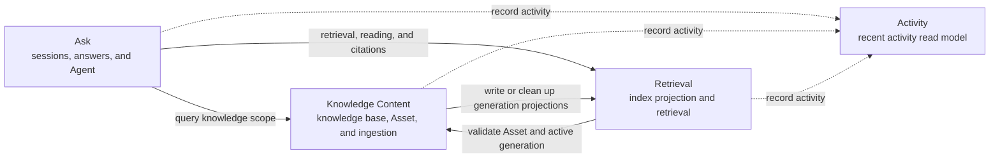
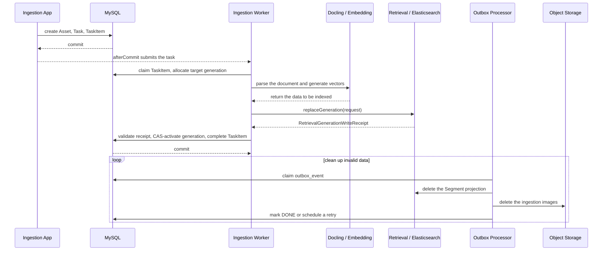

# Domain boundaries and interactions

This document records the current domain boundaries, state ownership, in-process contracts, and cross-store consistency strategy of Anchr App.

The content is governed by the source code and database migrations and is updated in step with the implementation.

> [!IMPORTANT]
> The supported boundary of the current system is **single-instance, single-tenant**: one deployment runs only one Anchr App process and serves one organization or team. The `user_id`, roles, and knowledge scope mentioned in this document all live inside that tenant and do not constitute cross-tenant isolation; the localized use of Leases, conditional updates, or query-based recovery also does not mean that the system supports multiple App replicas. For the complete constraints, see [Chinese technical documentation](./technical.zh-CN.md#%E5%8D%95%E5%AE%9E%E4%BE%8B%E5%8D%95%E7%A7%9F%E6%88%B7%E6%9E%B6%E6%9E%84%E7%BA%A6%E6%9D%9F).

## 1. System boundaries and terminology

The Anchr App backend is a Spring Boot modular monolith. All modules run in the same process, but business state does not share ownership:

- MySQL stores business facts, task state, and reliable compensation events.
- Elasticsearch stores retrieval-oriented Segment projections and the physical index topology.
- Redis stores rebuildable state such as authentication information, ID allocation ranges, query rewrite caches, and Agent runtime snapshots.
- Object storage stores original documents, preview resources, and images produced during ingestion.
- AI, Docling, and object storage are out-of-process vendor capabilities, accessed through ports or application contracts.

Terminology:

- **Domain context**: a logical boundary that owns a set of business rules and the final say over state interpretation.
- **Physical module**: a first-level Java package under `com.anchr.core`. One domain context may be implemented jointly by multiple physical modules.
- **Application API**: the stable in-process contract published by a provider, located in `application.api`.
- **ACL**: the anti-corruption layer owned by the caller, located in the caller's `application.acl`, responsible for semantic conversion and dependency containment.
- **Domain Port**: the outbound capability interface defined by the business side, implemented by a vendor adapter in `integration`.
- **Business fact**: the state that has the final say when conflicts arise; caches, projections, and activity snapshots are not business facts.

## 2. Domain map



In the diagram:

- Solid lines denote core business calls; the arrow points to the context being depended upon and does not denote state ownership.
- Dashed lines denote best-effort activity recording; a recording failure usually does not roll back the main business flow.
- Knowledge Content and Retrieval collaborate in both directions, but each owns different facts: the former decides the Asset and the active generation, while the latter maintains the Segment projection and executes retrieval.
- Cross-context calls go through the caller's ACL and the provider's Application API by default.

### 2.1 Supporting contexts and technical resources

| Supporting boundary | Role in the current system | Main connections |
| --- | --- | --- |
| Auth | Authentication, roles, and request user context | All REST/SSE entry points; calls Capability when temporary credential storage is needed |
| Capability & Provider | Manages AI/storage configuration and adapts external vendors | Implements the respective Domain Port for Ask, Knowledge Content, Retrieval, and Auth |
| Technical Kernel | Unified errors, return values, IDs, encryption, and technical configuration | Reused by every module, but owns no business state |
| MySQL | Authoritative business facts, tasks, and reliable compensation events | Knowledge Content, Ask, Activity, Capability |
| Elasticsearch | Segment retrieval projections and physical index topology | Retrieval |
| Redis | Authentication, caches, ID allocation ranges, and Agent runtime snapshots | Auth, Ask, and the technical infrastructure |
| Object Storage | Original documents, preview resources, and ingestion images | Knowledge Content and Retrieval access it through their own ports |
| AI Providers / Docling | Generation, Embedding, Rerank, and document parsing | Integrated through Capability/Integration or the consumer-side ports |

## 3. Domain boundaries and state ownership

### 3.1 Knowledge Content: knowledge content and ingestion

**Physical modules**: `kb`, `ingestion`

**Responsibilities**:

- Manage the creation, archival, deletion, and statistics of knowledge bases and Assets.
- Manage uploads, idempotent creation, ingestion tasks, and task item state.
- Orchestrate parsing, image processing, Embedding, index writing, and generation activation.
- Decide the `activeIndexGeneration` currently visible for an Asset.
- Manage the business lifecycle of original objects and ingestion images.
- Reliably clean up the external projections of deleted Assets or invalidated generations through a dedicated Outbox.

**Owned business state**:

- MySQL: `knowledge_base`, `asset`, `ingestion_task`, `ingestion_task_item`, `outbox_event`.
- Original documents and ingestion artifacts in object storage, whose locations are resolved jointly by business records and storage configuration.

`kb` and `ingestion` are two physical packages belonging to the same Knowledge Content. Ingestion task creation, generation reservation, Asset locking, and activation share short transactions and business invariants, so they are allowed to use Repositories and domain types directly.

Knowledge Content only decides which generation is visible; the Elasticsearch index structure and retrieval ordering belong to Retrieval.

### 3.2 Retrieval: retrieval and index projection

**Physical module**: `search`

**Responsibilities**:

- Manage Elasticsearch physical indices, read/write aliases, and Embedding profile compatibility.
- Write, replace, and delete the Segment projection of an Asset generation.
- Execute keyword, text vector, and document image vector recall.
- Execute RRF fusion, visible generation filtering, diversity control, Rerank, and Asset aggregation.
- Provide Segment preview, document content reading, citation reason generation, and retrieval explanation.
- Orchestrate index rebuild and alias switching after an Embedding profile change.

**Owned state**:

- Segment documents, physical indices, read aliases, and write aliases in Elasticsearch.
- In-process index lifecycle state, pending-confirmation rebuild tasks, and write barrier state.

A Segment is the retrieval projection of an Asset generation. Business visibility is decided by the Knowledge Content knowledge base, Asset, and active generation, and cannot rest on an Elasticsearch hit alone.

### 3.3 Ask: sessions, question answering, and Agent

**Physical module**: `conversation`, within which `application.agent` is an internal submodule of Ask.

**Responsibilities**:

- Manage session and Turn lifecycle.
- Execute intent routing for CHAT, OTHER, KB_QUERY, and so on.
- Orchestrate traditional RAG: question rewriting, retrieval, evidence filtering, answer generation, citations, and result cards.
- Orchestrate the Agent tool loop, run traces, asynchronous tasks, recovery, cancellation, and SSE push.
- Save the evidence snapshot actually used when answering.

**Owned business state**:

- MySQL: `conversation_session`, `conversation_turn`, `agent_run`, `agent_step`, `agent_task`.
- Redis: the Agent's latest runtime snapshot; it is a best-effort cache, and the session, task, and trace records in MySQL are the authoritative state.
- In-process: transient state such as Agent cancellation registrations, run threads, and SSE subscribers.

Ask does not own knowledge bases, Assets, or Segments. The knowledge scope is queried through `ConversationKnowledgeAcl`, and retrieval and document content are obtained through `ConversationRetrievalAcl`. The Agent is an execution mode of Ask and does not constitute a separate business context.

### 3.4 Activity: recent activity read model

**Physical module**: `activity`

**Responsibilities**:

- Store UI activities such as recent questions, searches, citation opens, and document imports.
- Query recent activity by user.
- Query Knowledge Content to fill in knowledge base names that are still valid.

**Owned state**:

- MySQL: `activity_event`.

The Activity payload is a display snapshot and does not serve as an audit record of sessions, Assets, citations, or retrieval results. A write failure does not roll back the main business flow; when a session or Asset is deleted, the caller explicitly cleans up the associated activities.

### 3.5 Capability & Provider: capability configuration and vendor adaptation

**Physical modules**: `settings`, `integration`

**Responsibilities**:

- Manage AI capability configuration such as generation, Embedding, and Rerank.
- Manage object storage configuration, encrypted fields, and temporary access credentials.
- Manage the runtime parameters of Search, Conversation, Agent, Ingestion, and Outbox.
- Resolve the currently effective configuration, and create and cache vendor clients.
- Implement the outbound ports owned by Ask, Retrieval, Knowledge Content, and Auth respectively.
- Coordinate Retrieval to complete index deployment when the Embedding configuration switches.

**Owned business state**:

- MySQL: `capability_config`, `storage_config`, `runtime_config`.
- In-process: vendor client caches.

`settings` manages the lifecycle of capability, storage, and runtime configuration, while `integration` adapts vendor protocols and SDKs; the two form a single supporting context. The same adapter may implement multiple consumer-side ports, but it does not expose a generic vendor interface to the business layer.

### 3.6 Auth and Technical Kernel

**Physical modules**: `auth`, `common`

`auth` is responsible for access tokens, roles, TTL, user context, and request interception. Authentication state is mainly kept in Redis; when temporary object storage credentials are needed, it calls `StorageRuntimeApi` through `AuthStorageAcl`.

`common` carries only unified return values, error codes, IDs, encryption, health checks, and a small number of stable technical structures. Asset, Segment, Conversation, and vendor business models are not placed in `common`.

## 4. Ownership of key state and terms

| Term | Owner | Current meaning |
| --- | --- | --- |
| Knowledge Base | Knowledge Content | The business container for Assets, together with its visibility and statistics state |
| Asset | Knowledge Content | The original document and its ingestion lifecycle |
| target generation | Knowledge Content | The content version reserved by an ingestion task item and not yet activated |
| active generation | Knowledge Content | The Asset content version currently allowed to be read by the business |
| Segment | Retrieval | The retrieval projection derived from one Asset generation |
| physical index / alias | Retrieval | Elasticsearch storage and routing topology |
| Embedding profile | Capability + Retrieval | Capability manages the configuration; Retrieval judges index compatibility and performs the deployment |
| Conversation / Turn | Ask | The persisted snapshot of a user session and one question-answer exchange |
| Evidence / Citation | Ask | The retrieval evidence registered and actually used by Ask; the source data is provided by Retrieval |
| Agent Run / Step / Task | Ask | Agent execution, trace, and asynchronous scheduling state |
| Activity Event | Activity | A snapshot for the recent activity UI |
| Provider Configuration | Capability | The desired and effective configuration for AI and object storage |

Three versions that are easy to confuse:

1. `asset.active_index_generation` is the content visibility version, activated by Knowledge Content.
2. The generation recorded in a Segment document identifies which content version it comes from, and is stored by Retrieval as a projection field.
3. The Elasticsearch physical index version belongs to Retrieval infrastructure and can hold multiple Asset generations at the same time; it is not the same concept as the active generation of a single Asset.

## 5. Interaction rules

### 5.1 Direct collaboration within the same context

Physical modules in the same domain context may use domain objects and Repositories directly:

- `kb` and `ingestion` share the Asset, ingestion task, and generation activation transaction.
- `settings` and `integration` share vendor configuration resolution, the client factory, and cache invalidation.

Direct collaboration is limited to modules that share the same business invariants.

### 5.2 Cross-context synchronous calls

Cross-context synchronous calls follow:

```text
caller use case -> caller ACL -> provider application.api -> provider application service
```

Provider APIs use immutable Application Models; the caller ACL converts them into local models, aggregates, or commands. REST DTOs are not used as in-process contracts.

The main current contracts are as follows:

| Caller | Caller ACL | Provider Application API | Purpose |
| --- | --- | --- | --- |
| Auth | `AuthStorageAcl` | `StorageRuntimeApi` | Obtain the storage location and temporary credentials |
| Activity | `ActivityKnowledgeAcl` | `KnowledgeContentQueryApi` | Fill in valid knowledge base names |
| Ask | `ConversationKnowledgeAcl` | `KnowledgeContentQueryApi` | Validate the session knowledge scope and query document metadata |
| Ask | `ConversationRetrievalAcl` | `RetrievalHitQueryApi` | Obtain retrieval candidates for question answering |
| Ask | `ConversationRetrievalAcl` | `RetrievalDocumentContentQueryApi` | The Agent reads document content by scope |
| Ask | `ConversationRetrievalAcl` | `RetrievalCitationReasonApi` | Generate citation reasons for the evidence already used |
| Ingestion | `IngestionRetrievalAcl` | `RetrievalGenerationIndexApi` | Write or replace the generation projection |
| Knowledge Content | `KnowledgeRetrievalCleanupAcl` | `RetrievalCleanupApi` | Delete the Asset or generation projection |
| Retrieval | `SearchKnowledgeAcl` | `KnowledgeContentQueryApi` | Query the visible knowledge scope and active generation |
| Retrieval | `RetrievalCapabilityAcl` | `CapabilityServingConfigApi` | Read and activate the effective Embedding configuration |
| Capability | `CapabilityRetrievalAcl` | `RetrievalEmbeddingDeploymentApi` | Request and confirm the Embedding index deployment |
| Each business context | Its own Activity ACL | `ActivityRecordApi` | Record activity on a best-effort basis |
| Ingestion / Knowledge | Its own Storage ACL | `StorageRuntimeApi` | Obtain storage snapshots and temporary credentials |

The public search interface uses `RetrievalTopNQueryApi` to return bounded Top-N results; Ask uses `RetrievalHitQueryApi` to obtain candidates that can continue to participate in answer orchestration. The two entry points share the retrieval core, but their output semantics differ.

### 5.3 External vendor calls

AI and object storage use consumer-side-owned Domain Ports:

- Ask: `AgentModelPort`, `ConversationGenerationPort`
- Ingestion: `IngestionEmbeddingPort`, `IngestionObjectStoragePort`
- Knowledge Content: `KnowledgeObjectStoragePort`
- Retrieval: `SearchEmbeddingPort`, `SearchGenerationPort`, `SearchRerankPort`, `SearchObjectStoragePort`

The `ConfigDriven*Adapter` classes in `integration` implement these ports and select clients according to Capability configuration. The business layer depends only on capability interfaces, not on vendor SDKs.

Docling is currently integrated through `IngestionDoclingAcl` to `integration.ai.client.DoclingClient`. The ACL is responsible for converting vendor states, errors, and responses into ingestion semantics.

### 5.4 Process Coordinator, Outbox, and best-effort

The project does not use a generic command bus or a global event bus. The coordination approach is chosen according to the consistency requirement:

- **Application Process Coordinator**: when one use case spans multiple local steps or external capabilities, the application service orchestrates them explicitly, for example ingestion, question answering, and index rebuild.
- **Knowledge Content dedicated Outbox**: when a business transaction must reliably trigger Elasticsearch/object storage cleanup, it first persists `outbox_event`, and a poller then executes it.
- **after-commit / best-effort**: side effects that must not break the main business flow, such as recent activity, statistics refresh, and the Docling ACK, are executed after the main transaction commits, or their failures are captured.

## 6. Key business interactions

### 6.1 Document ingestion and generation activation

The ingestion pipeline first persists the task, then processes the document, writes the retrieval projection, and activates the generation. Invalid data is cleaned up by the Outbox.



Task creation uses the `REQUIRES_NEW` transaction of `IngestionCreateTransactionRunner`. The losing side of a concurrent idempotency race rolls back first and then reads the winner's result in a new transaction. After a Worker claims a task item, `IngestionStageTransactionCoordinator` locks the Asset and reserves `targetIndexGeneration` in a short transaction; Docling, Embedding, and Elasticsearch calls do not hold a database transaction.

Retrieval first deletes the old projection of the same Asset/generation, then writes in batches and returns `RetrievalGenerationWriteReceipt`. `IngestionIndexFinalizer` locks the task item and the Asset, validates the receipt, and then activates the generation through CAS.

There is no distributed transaction between MySQL and Elasticsearch. Visibility is controlled by the active generation:

| Result | Visibility and follow-up handling |
| --- | --- |
| Elasticsearch write fails | Not activated; the new data is invisible |
| Write and activation succeed | The new generation is visible, and the old generation is written to the Outbox awaiting cleanup |
| Write succeeds, activation fails | The new generation is invisible, and is written to the Outbox for cleanup |

When a document is updated from generation 3 to 4, reads still use 3 while the build is in progress; once the activation commits, only 4 is read. Before the Outbox finishes cleanup, Elasticsearch may retain both versions at the same time, but queries never mix them. The active generation of a first import is 0, and the document does not enter retrieval results until generation 1 is activated.

If parsing, Embedding, index writing, or the Finalizer fails, `failRunning` marks the task as failed in a short transaction and writes a cleanup event for the not-yet-activated target generation. The Docling ACK is executed best-effort after the transaction.

`OutboxEventProcessor` claims events with a lock token, deletes the ingestion images and the Segment projection outside the transaction, and then marks them complete or schedules a retry. Workers do not resume external calls that were in flight before a process restart; `RUNNING` task items left over at startup are marked failed, and the user initiates a retry of the whole document.

### 6.2 Retrieval, visibility filtering, and preview

Retrieval pipeline:

```text
REST Search or Ask
  -> Retrieval Query API
  -> KnowledgeContentQueryApi resolves the visible knowledge scope
  -> query vector generation
  -> keyword + text vector + document image vector recall
  -> RRF fusion
  -> filter by Knowledge Content active generation
  -> diversity control and bounded Rerank
  -> Asset aggregation / Hit output
```

Constraints:

- Elasticsearch recall results are only candidates and must go through Knowledge Content's active generation filtering.
- Filtering happens after recall, so an old generation never becomes a business-visible result even if the Outbox has not yet physically deleted it.
- Segment preview validates again whether the Asset and generation are valid; an expired Segment returns as invisible rather than directly exposing Elasticsearch content.
- Document metadata and the visible scope are obtained through `SearchKnowledgeAcl`, and object preview URLs are signed through `SearchObjectStoragePort`.
- Search activity is recorded by the interface layer through `SearchActivityAcl` after a successful return and does not participate in the consistency of retrieval results.

### 6.3 Traditional RAG and Agent question answering

`ConversationServiceImpl` is the interface-layer facade; `ConversationMessageUseCase` and `ConversationMessageOrchestrator` are responsible for orchestration.

Traditional question answering flow:

1. Load or create the session, and resolve the user's visible knowledge scope through `ConversationKnowledgeAcl`.
2. Generate the Turn/Run identifier and execute intent routing.
3. An explicit CHAT invokes ordinary answer generation; all other valid requests and classification anomalies default to KB_QUERY; for KB_QUERY, `TraditionalRagRewriteService` outputs the complete question and the keyword array in one pass and retrieves once through `ConversationRetrievalAcl` (RRF/Rerank is executed internally).
4. The traditional dedicated strategy selects full chunks by retrieval rank: at most 5 assets, 3 chunks per asset, 10 chunks in total, and the evidence section including metadata is at most 24000 Unicode characters. Over-budget chunks are skipped whole, without expanding neighbouring chunks or reading the full text; evidence is selected first and then aggregated by asset, and the cards do not constrain the evidence in return. The answer model is called at most once, a partial lack of evidence is stated explicitly, and a complete lack of evidence results in a refusal. The backend maps local citations into a two-level numbering and keeps only the chunks actually cited; the historical single-level numbering remains compatible.
5. Keep only the citations that the answer actually used and that are still valid, and generate citation reasons through Retrieval.
6. Save the Turn in a transaction; after success, record the QUESTION activity on a best-effort basis.

The dedicated rewrite above is called only by traditional RAG (including the traditional fallback after an Agent exception) and does not change the behaviour of Search, Agent, or the shared rewrite. Keywords are passed to the existing text retrieval through a compatible overload; vectors and reranking use the complete query, and old callers default to empty keywords. There is no Planner, no coverage model, and no supplementary-query loop. The front-end traditional citation cards are at most 5, scroll horizontally in a single row, and open a multi-chunk overlay for selection and precise positioning; the Agent display stays unchanged. Traditional SSE incrementally sends provisional body text with converted citation numbers and calibrates it after final validation; the complete question and search query are stored in the Turn's `retrieval_trace.resolvedQuestion/searchQuery/keywords`.

Agent mode reuses the same knowledge scope and retrieval boundary:

- Tools such as `find_documents`, `search_knowledge`, `read_document`, `summarize_documents`, and `deliver_answer` are orchestrated by Ask.
- Scope Guard and document reading are done through `ConversationKnowledgeAcl` and `ConversationRetrievalAcl`, and the Knowledge Repository or Elasticsearch Repository is not exposed to the Agent.
- Agent Run, Step, and Task are persisted to MySQL; asynchronous tasks are saved first and triggered after the transaction commits, and the scheduler can continue to claim unfinished tasks.
- The Redis Runtime Snapshot is used only to display the latest run state quickly; a read or write failure does not change the authoritative state in MySQL.
- SSE is a transport and subscription mechanism and does not establish a separate question answering business flow.
- Conversation SSE, asynchronous Task SSE, polling, and Snapshot use the same `turnId` answer identity; real-time deltas are provisional, and the canonical terminal state in the MySQL Turn is the final fact.
- The Answer Event Broker shared by Conversation and Task guarantees only in-JVM real-time delivery; Redis Pub/Sub is not currently used. Task/Turn queries can only be used for reconnection and restart recovery within a single instance, and multiple App replicas must not be deployed on that basis.

### 6.4 Embedding configuration deployment and index switching

Embedding configuration distinguishes saved from effective:

1. Capability saves the configuration. If the fingerprint of the candidate Embedding profile is incompatible with the currently effective profile, the configuration is not switched immediately.
2. `CapabilityConfigServiceImpl` requests, through `CapabilityRetrievalAcl`, that Retrieval create a pending-confirmation rebuild task.
3. After the user confirms, `SegmentIndexManagerImpl` acquires the exclusive permit of `SegmentIndexWriteBarrier`, checks the current alias topology, creates a new physical index, and migrates/regenerates projections.
4. After validating the document count and the profile, it switches the read/write aliases and then activates the Capability configuration through `RetrievalCapabilityAcl`.
5. If configuration activation fails, Retrieval attempts to switch the aliases back to the old physical index. A new index is deleted only when it is no longer referenced by an alias.
6. On success, the old physical index is retained as an explicit rollback snapshot and is not automatically treated as garbage and deleted.

Ordinary Segment writes hold a shared permit of the write barrier; a rebuild holds the exclusive permit, preventing late writes from still landing in the old index during the alias switch.

Pending-confirmation rebuild tasks and lifecycle state are kept in the process. After a process restart, the state can be re-checked from the Elasticsearch topology; the unconfirmed tasks themselves are not persisted to the database.

### 6.5 Asset deletion and reliable cleanup

When an Asset is deleted, Knowledge Content performs the following in the same MySQL transaction:

1. Lock and update the Asset business state.
2. Clean up the citation activities associated with the Asset.
3. Update the knowledge base statistics.
4. Save the `DELETE_ASSET` Outbox event.

If the Outbox write fails, the Asset deletion transaction rolls back, avoiding "the business record is deleted but no external cleanup record will ever exist".

A generation switch or an ingestion failure saves `DELETE_ASSET_GENERATION`. `OutboxEventProcessor` claims events in batches using a lock token and a lease, and executes outside the database transaction:

- Delete the ingestion image prefix of the corresponding Asset/generation.
- Delete the Elasticsearch Segment projection through `RetrievalCleanupApi`.

Operations are designed to be idempotent by Asset/generation. Temporary failures back off at 1, 5, 30, 120, 720, and 1440 minutes, and subsequent retries continue to use the maximum interval; by default there are at most 10 attempts. An invalid payload goes directly to the failed state. Completed events are retained for 90 days by default and are cleaned up in a daily batch at 03:00 (Asia/Shanghai).

This Outbox is used only for Knowledge Content external cleanup.

### 6.6 Activity recording and cleanup

Activity is a weakly consistent read model:

- Ask, Search, and Ingestion record activity after the main flow succeeds or commits.
- The caller ACL and the recording service isolate write exceptions; an Activity failure does not roll back an answer, a search, or ingestion.
- A recent activity query calls `KnowledgeContentQueryApi` to fill in currently valid knowledge base names.
- When a session or Asset is deleted, the caller cleans up the associated Activity synchronously; this operation is lifecycle cleanup and does not go through the ordinary best-effort recording path.

### 6.7 Storage and Docling

Capability publishes storage location snapshots and temporary credentials through `StorageRuntimeApi`. Business contexts only store or pass the object keys they need and do not read the configuration Repository of another context directly.

`ConfigDrivenStorageAdapter` decrypts credentials according to the current configuration and implements each consumer-side Object Storage Port. Before submitting a Docling task, Ingestion fixes the target endpoint, bucket, and prefix, and checks when signing the temporary credential that the target has not drifted, preventing a parsing task from writing to a location inconsistent with the original request.

`DoclingClient` uses an authenticated asynchronous HTTP job protocol and limits the response body size. Ingestion is responsible for submission, polling, backoff, error classification, and the final ACK; vendor calls are not wrapped in long database transactions.

## 7. Consistency and failure semantics

| Boundary | Consistency strategy | System semantics after failure |
| --- | --- | --- |
| A single MySQL aggregate/task state | Local transaction, row lock, CAS | The transaction rolls back and no partial business state is exposed |
| MySQL Asset and Elasticsearch Segment | target/active generation latch + Outbox | Unactivated projections are invisible; orphaned or old projections are cleaned up asynchronously |
| Embedding configuration and index aliases | Write barrier, migration validation, switch the aliases before activating the configuration, switch back on failure | The old topology is restored as far as possible; the old index is retained for an explicit rollback |
| Activity and the main business flow | after-commit / best-effort | At most the recent activity is missing; the business result does not change |
| Agent Redis snapshot and MySQL | Redis best-effort, MySQL authoritative | The cache may be missing or briefly stale; tasks and traces can still be recovered |
| Agent asynchronous triggering | Task persisted first, triggered after commit | If the immediate trigger fails, the persisted task can still be claimed by a later schedule |
| AI / Docling / Object Storage | Timeout, error classification, limited retry or compensation | XA is not promised; the specific use case decides failure, retry, or degradation |
| In-process index rebuild task | Atomic state + ES topology re-check | Pending-confirmation tasks are not retained after a restart, and the actual alias state can be re-checked |

## 8. Known boundary exceptions

A small number of direct package-level dependencies still exist:

- `kb <-> ingestion` and `settings <-> integration` are the same-context collaboration defined in this document.
- `integration` depends on the Domain Ports of Ask, Ingestion, Retrieval, and Knowledge Content, which is the outbound adapter dependency direction in the hexagonal architecture.
- Ingestion already expresses the data to be written with its own `IngestionIndexSegment`, and the generation write boundary has also been contained through `RetrievalGenerationIndexApi`; however, the Embedding preparation stage still directly reuses Retrieval domain types such as `EmbeddingProjectionPolicy`, `EmbeddingProjection`, and `SegmentType`.
- The Activity REST DTO/Assembler still reuses `CitationChunkSnapshotDTO` and `PreviewAnchorDTO` from the Retrieval interface layer. This is current presentation-layer coupling and does not mean that Activity owns Retrieval domain state.
- Segment Preview performs visibility validation by querying the Knowledge Content published model through `SearchKnowledgeAcl`, which is a compliant call; new cross-boundary requirements should likewise prefer extending the Application API/ACL rather than adding direct Repository or domain model dependencies.

New dependencies must not be justified by these exceptions.

## 9. Change checklist

When adding or modifying a cross-module flow, check:

1. Who owns the final business state, and which store prevails when a conflict occurs?
2. Is this same-context collaboration, a synchronous Query/Command, an external capability call, or a cross-store flow that needs reliable compensation?
3. Does the provider publish stable semantics through `application.api`, and does the caller isolate models through its own ACL?
4. Have external system calls been wrongly placed inside a long MySQL transaction?
5. Is a cache, Activity, Segment, or SSE snapshot mistakenly treated as a business fact?
6. Are retries idempotent, and who recovers, compensates, or marks a terminal state after a failure?
7. Does the new type belong to a provider contract, a caller model, a Domain Port, or the purely technical kernel?
8. Do changes to active generation, Embedding profile, index aliases, and task state preserve the invariants above?

## 10. Code index

### Knowledge Content and Ingestion

- [`KnowledgeContentQueryApi`](../src/main/java/com/anchr/core/kb/application/api/KnowledgeContentQueryApi.java)
- [`KnowledgeContentQueryApiImpl`](../src/main/java/com/anchr/core/kb/application/impl/KnowledgeContentQueryApiImpl.java)
- [`IngestionApplicationServiceImpl`](../src/main/java/com/anchr/core/ingestion/application/impl/IngestionApplicationServiceImpl.java)
- [`IngestionTaskProcessorImpl`](../src/main/java/com/anchr/core/ingestion/application/impl/IngestionTaskProcessorImpl.java)
- [`IngestionStageTransactionCoordinator`](../src/main/java/com/anchr/core/ingestion/application/impl/IngestionStageTransactionCoordinator.java)
- [`IngestionIndexFinalizer`](../src/main/java/com/anchr/core/ingestion/application/impl/IngestionIndexFinalizer.java)
- [`IngestionRetrievalAcl`](../src/main/java/com/anchr/core/ingestion/application/acl/IngestionRetrievalAcl.java)
- [`OutboxEventProcessor`](../src/main/java/com/anchr/core/kb/application/impl/OutboxEventProcessor.java)

### Retrieval

- [`RetrievalQueryServiceImpl`](../src/main/java/com/anchr/core/search/application/impl/RetrievalQueryServiceImpl.java)
- [`RetrievalGenerationIndexServiceImpl`](../src/main/java/com/anchr/core/search/application/impl/RetrievalGenerationIndexServiceImpl.java)
- [`RetrievalDocumentContentQueryServiceImpl`](../src/main/java/com/anchr/core/search/application/impl/RetrievalDocumentContentQueryServiceImpl.java)
- [`SegmentPreviewServiceImpl`](../src/main/java/com/anchr/core/search/application/impl/SegmentPreviewServiceImpl.java)
- [`SegmentIndexManagerImpl`](../src/main/java/com/anchr/core/search/application/impl/SegmentIndexManagerImpl.java)
- [`SegmentIndexWriteBarrier`](../src/main/java/com/anchr/core/search/application/SegmentIndexWriteBarrier.java)

### Ask and Agent

- [`ConversationMessageUseCase`](../src/main/java/com/anchr/core/conversation/application/impl/ConversationMessageUseCase.java)
- [`ConversationMessageOrchestrator`](../src/main/java/com/anchr/core/conversation/application/impl/ConversationMessageOrchestrator.java)
- [`ConversationMessagePipeline`](../src/main/java/com/anchr/core/conversation/application/impl/ConversationMessagePipeline.java)
- [`ConversationKnowledgeAcl`](../src/main/java/com/anchr/core/conversation/application/acl/ConversationKnowledgeAcl.java)
- [`ConversationRetrievalAcl`](../src/main/java/com/anchr/core/conversation/application/acl/ConversationRetrievalAcl.java)
- [`AgentWorkflowImpl`](../src/main/java/com/anchr/core/conversation/application/agent/AgentWorkflowImpl.java)
- [`AgentRuntimeSnapshotService`](../src/main/java/com/anchr/core/conversation/application/AgentRuntimeSnapshotService.java)

### Capability, Activity, and infrastructure

- [`CapabilityConfigServiceImpl`](../src/main/java/com/anchr/core/settings/application/impl/CapabilityConfigServiceImpl.java)
- [`StorageRuntimeServiceImpl`](../src/main/java/com/anchr/core/settings/application/impl/StorageRuntimeServiceImpl.java)
- [`RuntimeConfigServiceImpl`](../src/main/java/com/anchr/core/settings/application/impl/RuntimeConfigServiceImpl.java)
- [`ConfigDrivenStorageAdapter`](../src/main/java/com/anchr/core/integration/storage/ConfigDrivenStorageAdapter.java)
- [`ActivityRecordServiceImpl`](../src/main/java/com/anchr/core/activity/application/impl/ActivityRecordServiceImpl.java)
- [`ActivityQueryServiceImpl`](../src/main/java/com/anchr/core/activity/application/impl/ActivityQueryServiceImpl.java)
- [`Database migration directory`](../src/main/resources/db/migration)
