# Segment Index Online Rebuild Implementation Notes

This document records the current execution path, concurrency boundaries,
Embedding profile switching, failure recovery, and operating limits of `anchr-app`
Segment index online rebuilds.

## 1. Goals and constraints

An online rebuild migrates the current Segment index to a new physical index when
the Embedding model, vector dimension, or vector space configuration changes.

Current constraints:

- Only a single JVM and a single tenant are supported.
- The old physical index keeps serving reads and writes during the rebuild and is the
  authoritative data source throughout the migration.
- The new physical index is a shadow index with no alias bound, invisible to online queries.
- Ordinary writes neither call the target model synchronously nor dual write to the shadow
  index; after the write to the old index succeeds, only the `assetId` is registered as dirty.
- The dirty set, mutation sequence, and backfill position are kept in memory only.
- If the rebuild fails or the process restarts before the swap, the whole rebuild starts over
  and does not resume from a breakpoint.
- Read requests always go through the read alias, so reads are never interrupted during the rebuild.
- Write requests wait only inside the short exclusive windows of capture-boundary
  establishment and the final swap.

Core invariants:

1. Before the alias swap, the old index is the sole authoritative source of online data and incremental catch-up.
2. The shadow index does not serve traffic, so Asset synchronization deletes, regeneration, and writes do not need to be atomic with respect to online reads.
3. At the alias swap, the dirty set must be empty and the mutation sequence must match the one observed during the out-of-lock validation.
4. The vector fingerprint written to the new index must match the fingerprint in the new index metadata.
5. In `replaceGeneration`, deleting the old generation and writing the new Segments must not be split apart by the alias swap.

## 2. Components and responsibilities

| Component | Responsibility |
| --- | --- |
| `SegmentIndexManagerImpl` | Creates tasks, advances phases, controls the two exclusive windows, swaps alias/profile, handles failures and startup recovery |
| `SegmentIndexWriteBarrier` | Coordinates ordinary index writes and the final swap using a fair `ReentrantReadWriteLock` |
| `SegmentRebuildMutationTracker` | Maintains the mutation sequence and `assetId -> latestSequence` in memory |
| `SegmentIndexMigrationRunner` | `search_after` scanning, projection planning, batch Embedding, shadow index writes, Asset catch-up, and count validation |
| `SegmentPhysicalIndexFactory` | Creates physical indexes and reads/writes profile/rebuild metadata |
| `SegmentIndexAliasManager` | Validates the read/write alias topology and atomically swaps both aliases |
| `SegmentIndexTopologyInspector` | Reads the mapping/profile metadata of the index an alias points to and detects an interrupted swap |
| `RetrievalGenerationIndexServiceImpl` | Validates the ingestion fingerprint, re-vectorizes when needed, and atomically replaces the generation |
| `ConfigDrivenEmbeddingAdapter` | Opens a fixed-profile Session and adapts domain batch requests to the vendor Client |
| `SearchSegmentBulkWriter` | Writes to the write alias and registers the dirty Assets involved after success |
| `EsSegmentRepository` | Queries and deletes Segments; registers the dirty Asset after a successful delete |

`SegmentIndexManagerImpl.indexOpLock` is held for the entire rebuild, but it only serializes
management operations such as index creation and rebuilds. Ordinary ingestion does not acquire
this lock. Ordinary ingestion uses the shared permit of `SegmentIndexWriteBarrier`.

## 3. Overall phases

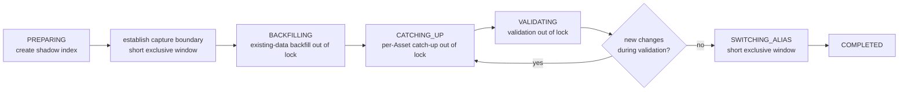

If any phase throws an unrecoverable exception, progress enters `FAILED`. The old index keeps
serving, and the target index with no alias bound is deleted afterwards.

## 4. Configuration selection and rebuild tasks

An Embedding configuration switch does not first modify the active configuration and then
rebuild. `CapabilityConfigServiceImpl` compares the current active profile with the target profile:

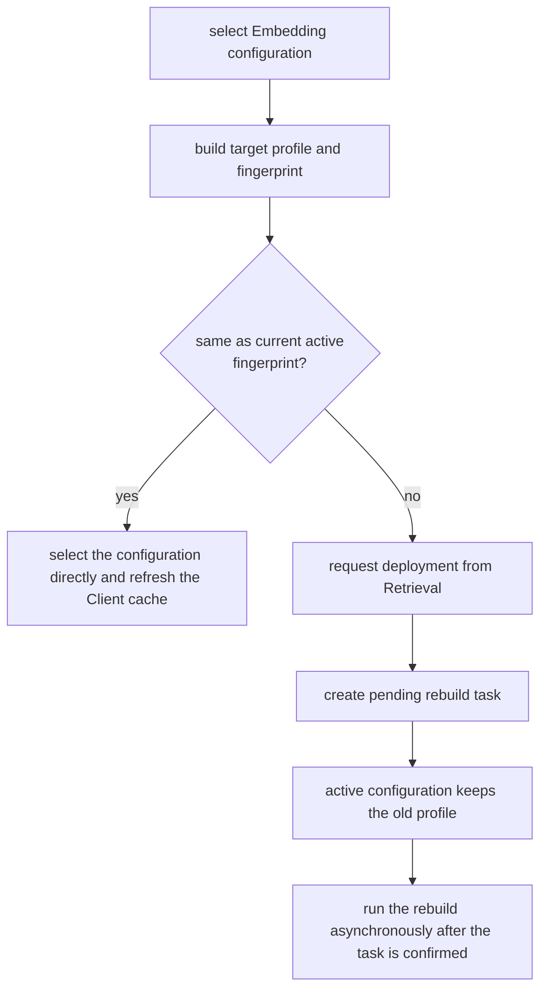

Repeated requests for the same target fingerprint reuse the existing task; a different target
replaces a pending task that has not started yet. After the task is confirmed, its state moves
from `READY` to `REBUILDING` and the initial phase is `PREPARING`.

The current REST entry points are unchanged:

| API | Purpose |
| --- | --- |
| `GET /api/v1/index/status` | Queries the index, profile, pending task, and rebuild progress |
| `POST /api/v1/index/rebuild/prepare` | Creates a to-be-confirmed task from the current active profile and the index metadata |
| `POST /api/v1/index/rebuild/confirm` | Confirms the given `taskId` and starts the rebuild asynchronously |

When the configuration management UI selects an Embedding configuration with a different
fingerprint, it also creates a to-be-rebuilt task through `RetrievalEmbeddingDeploymentApi`
instead of activating the target configuration directly.

## 5. Phase one: creating the shadow index

The rebuild thread first opens a fixed Session for the target Embedding profile, then reads and
validates the alias topology, obtains the name of the current old physical index, and creates the
shadow index.

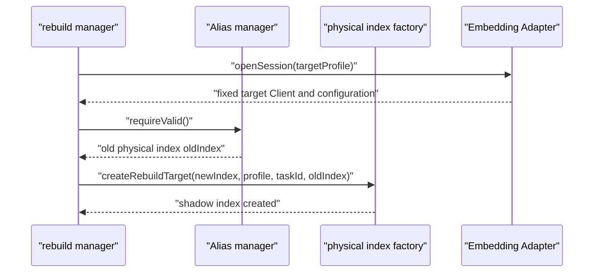

The target index mapping `_meta` is written with:

| Metadata | Meaning |
| --- | --- |
| `embeddingProfileVersion` | Currently fixed at `1` |
| `embeddingProfileFingerprint` | Target vector space identifier |
| `embeddingCapability` | `EMBEDDING` or `MULTI_EMBEDDING` |
| `embeddingModel` | Target model name |
| `embeddingDimension` | Target vector dimension |
| `embeddingConfigId` | Capability configuration ID, written when present |
| `rebuildTaskId` | ID of this task |
| `rebuildState` | Initially `BUILDING` |
| `rebuildSourceIndex` | Name of the old physical index |

The current fingerprint uses SHA-256 and is generated from the following fields after
normalization:

- capability;
- base URL with the trailing `/` removed;
- model name;
- `dimensions`.

The API Key does not enter the fingerprint and is not written to the index metadata.
`extraConfig` fields other than `dimensions` do not currently participate in the fingerprint.

## 6. Phase two: establishing the incremental capture boundary

After the target index is created, the rebuild thread acquires the exclusive permit of the write
barrier for the first time.

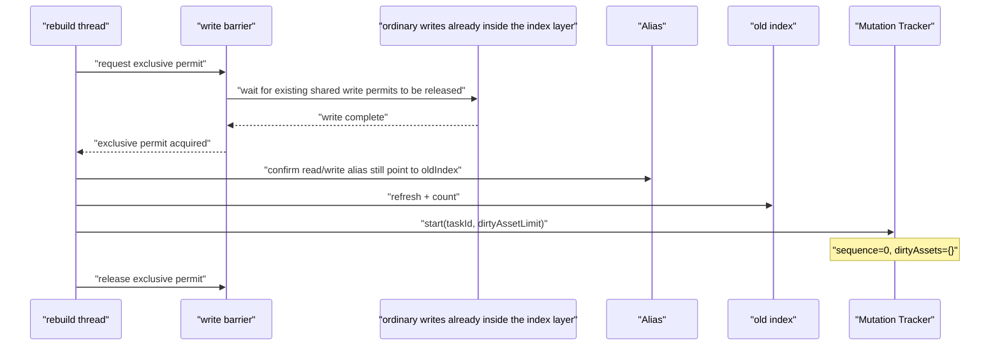

`SegmentRebuildMutationTracker.start` creates a fresh in-memory tracking state. The
implementation does not keep a separate field named `W0`; `sequence=0` of the new tracker is the
effective capture starting point of the current rebuild.

The following are not executed inside this exclusive window:

- scanning the old index;
- Embedding;
- batch writes to the shadow index;
- full validation.
## 7. Ordinary writes and dirty capture

Once capture is on, ordinary index operations still only write to the write alias, which at this
point still points to the old index. After success, the Assets involved are registered as dirty.

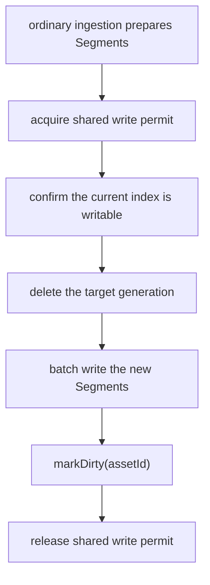

All of the following operations go through the shared write permit and participate in capture:

- `replaceGeneration`;
- `deleteByAssetId`;
- `deleteByAssetGeneration`;
- `SearchSegmentBulkWriter.write`.

`replaceGeneration` holds one shared permit in the outer scope so that the generation delete and
the batch write cannot be split apart by the final alias swap. The shared permits acquired again
inside the Repository and the BulkWriter are reentrant read locks of the same
`ReentrantReadWriteLock` and do not shrink the outer critical section.

Behavior of `markDirty`:

1. Increment the global sequence by one.
2. Update `dirtyAssets[assetId]` to the latest sequence.
3. Merge multiple changes to the same Asset into a single record of the latest version.
4. Set the overflow flag when the number of dirty Assets exceeds `rebuildDirtyAssetLimit`.
5. Overflow does not fail the current ordinary write; the rebuild thread terminates the rebuild
   after observing the flag during the catch-up phase.

## 8. Phase three: existing-data backfill out of lock

Once incremental capture is on, the rebuild thread releases the exclusive permit and scans the old
physical index directly, writing to the shadow index.

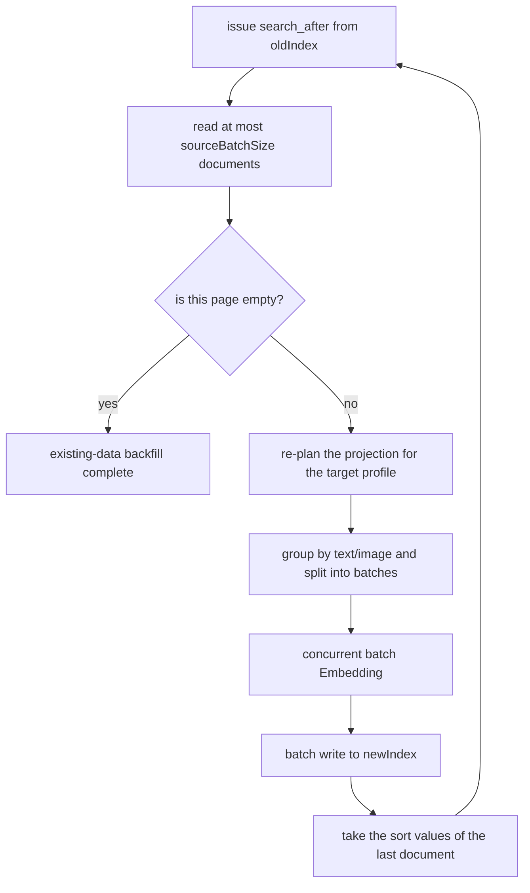

### 8.1 `search_after` sorting

Each page reads 200 source documents by default, with sort fields in this order:

1. `assetId ASC`;
2. `indexGeneration ASC`, missing values first;
3. `segmentType DESC`, missing values last;
4. `segmentId ASC`.

`segmentId` is the final stable sort key. The next page uses the complete sort values of the last
Hit on the previous page. The current implementation no longer creates a five-minute scroll
context, so a slower model call cannot cause the scroll to expire.

The old index may change during the scan:

- If the scan sees the old state first, the subsequent dirty Asset synchronization overwrites it with the final state;
- If the scan happens after an ordinary write, it may see the new state directly, and the dirty Asset synchronization still overwrites it again;
- If the scan encounters already deleted data it does not write it, and the delete operation itself also registers the dirty Asset.

### 8.2 Projection planning

`SegmentRebuildProjectionPlanner` decides the Segment shape again from the target capability:

- Text documents keep `TEXT_CHUNK`;
- Under a text model, images keep `IMAGE_OCR_BLOCK` and do not keep `IMAGE_VISUAL`;
- Under a multimodal model, images keep the OCR projection, and one `IMAGE_VISUAL` is generated for
  each Asset generation;
- `DOCUMENT_IMAGE` regenerates the image vector from the stable `sourceRef`;
- Every target projection that needs a vector first clears the old embedding and then generates it with the target Session.

Image object keys are converted into model input through short-lived signed URLs; input that is
already a stable HTTP/HTTPS address is used directly.

### 8.3 Batch Embedding

Projections to be vectorized are first grouped by `sourceType`. `text` is split into batches by
`rebuildEmbeddingBatchSize`; `image` and unknown types use the most conservative strategy, fixed
at one entry per batch. By default at most two batches run concurrently.

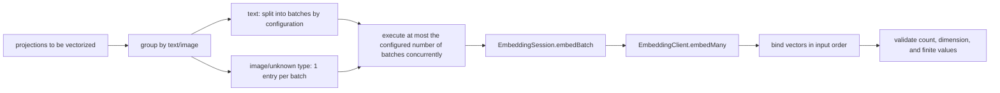

Interface layering:

- `SearchEmbeddingPort.EmbeddingSession.embedBatch` is the Search domain batch interface; by
  default it can degrade to one call per entry.
- `EmbeddingClient.embedMany` is a mandatory batch interface on the vendor Client and has no default implementation.
- `TextEmbeddingClient` puts multiple texts into a single request.
- `MultiEmbeddingClient` supports a content list; the rebuild caller only merges text, and passes
  only one image per call.
- When the Adapter encounters an input type the current Client does not support, it may explicitly
  call entry by entry, but it does not insert a fixed sleep.

The response must match the input count. Each vector must also satisfy the target dimension and
must not contain `null`, `NaN`, or infinite values.

Exponential backoff runs only when the error chain contains `429`, `Throttling`, `RateQuota`, or
`rate limit`. The default base is 5 seconds, the wait sequence is roughly 5, 10, 20, and 40
seconds, with random jitter of up to plus or minus 20%; a single batch is attempted at most 5
times. Ordinary model errors fail immediately without a pointless wait.
## 9. Phase four: incremental per-Asset catch-up

When the existing-data backfill completes, the process enters `CATCHING_UP`. Each round takes a
snapshot of the dirty set, and the snapshot value is the version `V` of the Asset at that moment.

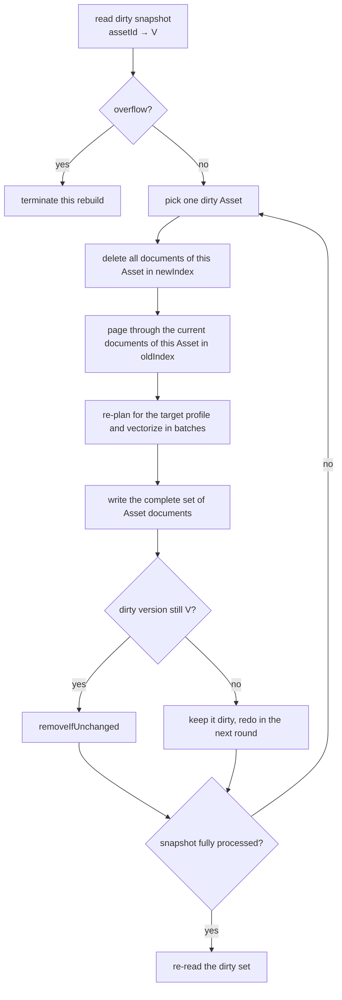

When an Asset is deleted, the old index returns an empty set; that Asset in the target index is
deleted and nothing is written afterwards, so a delete cannot be resurrected by the existing-data
backfill.

If a new write occurs during Asset synchronization, `markDirty` advances the version beyond `V`.
`removeIfUnchanged(assetId, V)` then fails to delete, and the Asset is kept for the next round.
This prevents an old synchronization result from overwriting a new state produced during the
synchronization.

A failure part-way through synchronizing a single Asset only leaves the shadow index, which does
not serve traffic, in a partial state. The current implementation does not roll back that Asset
inside the shadow index; instead it terminates the whole rebuild and deletes the target index.

## 10. Phase five: validation out of lock

Once the dirty set is empty, the process enters `VALIDATING`.

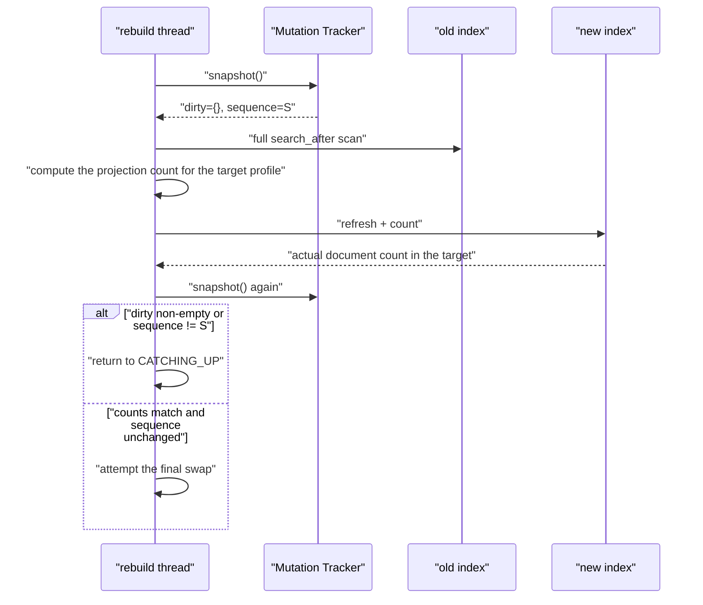

The current validation compares:

- the current source document count of the old index;
- the expected projection count after re-planning for the target profile;
- the actual document count of the new index.

The source document count and the target projection count are allowed to differ; for example,
switching to a multimodal profile may add `IMAGE_VISUAL`. Validation does not call Embedding, but
it does rescan the old index and run projection planning.

## 11. Phase six: final swap

Once the out-of-lock validation is stable, the rebuild thread acquires the exclusive permit of the
write barrier for the second time.

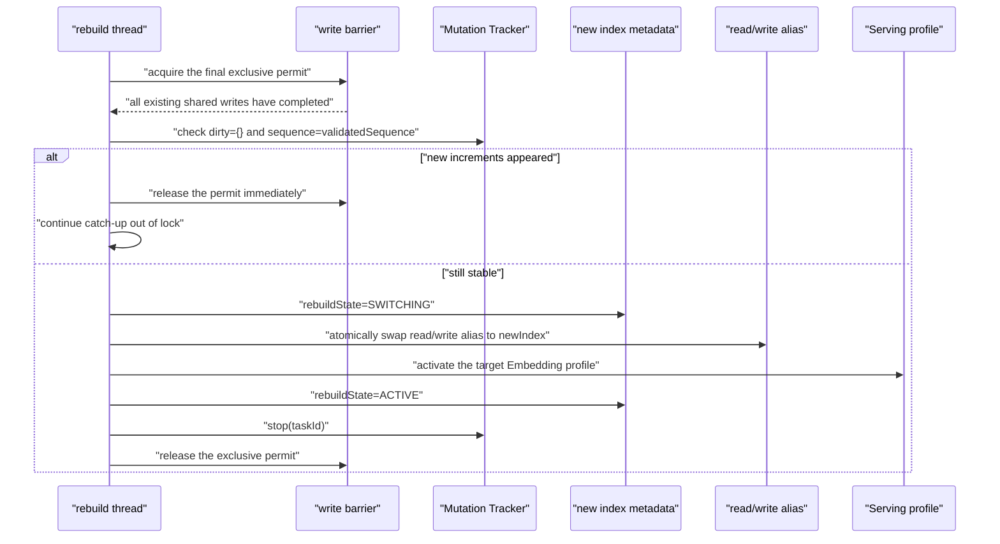

The final exclusive window only performs the version recheck, metadata updates, the alias swap,
and profile activation; it does not perform:

- Embedding;
- scanning the old index;
- existing-data backfill;
- Asset catch-up;
- full count validation.

The alias update uses an atomic Elasticsearch `_aliases` request that moves the read alias and the
write alias with `is_write_index=true` together. After the swap completes, the alias topology is
read once more to confirm the target index.

If profile activation fails, the manager swaps the alias from the new index back to the old index
within the same exclusive window and then fails the rebuild. The old index therefore continues to
serve reads and writes.

## 12. Ingestion across a swap and the profile fingerprint

Ingestion calls `IngestionEmbeddingPort.openSession()` once at the start of the `EMBED` phase.
`ConfigDrivenEmbeddingAdapter` pins the Client, configuration, multimodal capability, and
fingerprint resolved at that moment into the Session. All vectors of the same document use that
Session.

The system-level active profile changes only at the final swap, but a document may start Embedding
before the swap and enter index writing only after it.

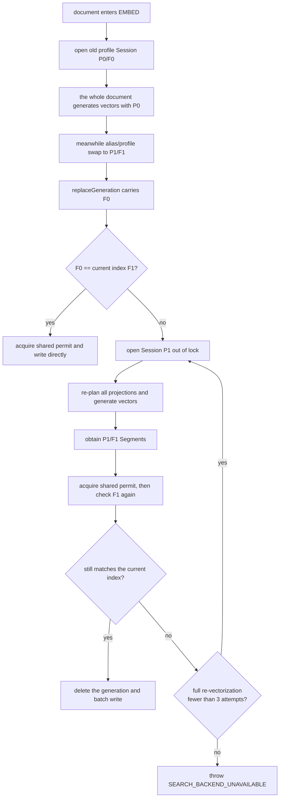

`RetrievalGenerationIndexRequest.embeddingProfileFingerprint` describes the vector space the
request's vectors belong to, not the Asset generation. The same dimension with a different model,
capability, or base URL still yields a different fingerprint.

Write order:

1. Compare the request fingerprint with the currently serving index fingerprint out of lock.
2. On a mismatch, read the current active profile and re-plan and re-vectorize out of lock.
3. Acquire the shared write permit.
4. Re-read the currently serving index fingerprint inside the permit.
5. On a match, delete the target generation and batch write within the same shared permit.
6. On a mismatch, release the permit and retry after regenerating out of lock with the latest profile.
7. Full re-projection and Embedding run at most 3 times; if still unstable at the limit, throw
   `SEARCH_BACKEND_UNAVAILABLE` without deleting the generation and without writing to the index.

Normal Ingestion calls always carry the fingerprint. The request model keeps a compatible
constructor without a fingerprint; such legacy calls are treated as already matching the currently
serving index and do not trigger automatic re-vectorization.

## 13. State and progress

Index lifecycle state:

```text
NOT_READY -> INITIALIZING -> READY -> REBUILDING -> READY
                                           |
                                           +-> rebuildProgress.phase=FAILED
```

Rebuild phases:

| Phase | Meaning |
| --- | --- |
| `PREPARING` | Task claimed; preparing the target Session and the shadow index |
| `BACKFILLING` | Scanning the old index and backfilling the shadow index |
| `CATCHING_UP` | Re-synchronizing per dirty Asset |
| `VALIDATING` | Rescanning out of lock and validating counts and sequence |
| `SWITCHING_ALIAS` | Inside the final exclusive window, about to swap alias/profile |
| `COMPLETED` | The new index is active |
| `FAILED` | This rebuild failed; the old index keeps serving |

`REBUILDING` no longer means the service is down:

- `readable=true`: queries keep reading the old alias;
- `writable=true`: ordinary ingestion keeps writing to the old alias;
- `rebuildProgress.dirtyAssets`: shows the number of dirty entries observed in this round during the `CATCHING_UP` phase.
## 14. Failures and restarts

### 14.1 Runtime failures

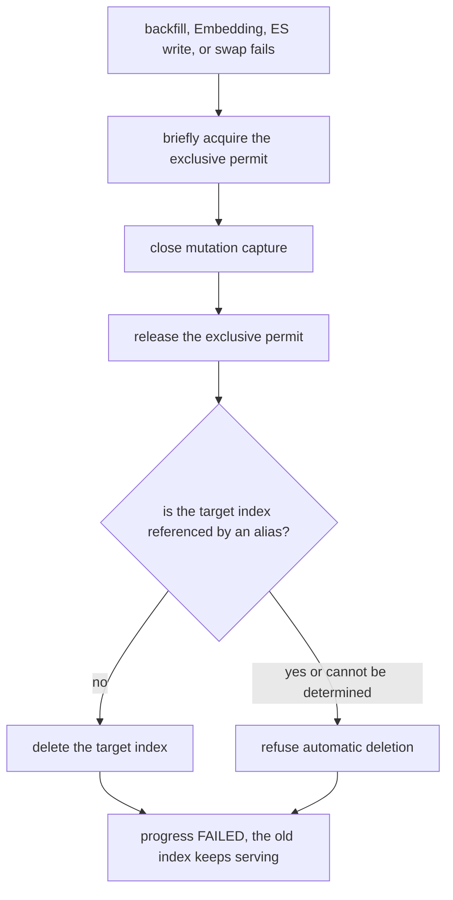

Ordinary write errors and rebuild errors are isolated: dirty overflow only fails the rebuild; a
successful write to the old index is not rolled back because of the shadow index, the target
model, or tracker overflow.

The current backfill and catch-up have no independent Elasticsearch retry loop. A Bulk, Delete, or
Search failure beyond what the client itself can absorb terminates the whole rebuild. Embedding
retries only explicit rate-limit errors.

### 14.2 Process restart

At application startup, the read/write aliases are read first and the indexes they point to are
added to a protection set:

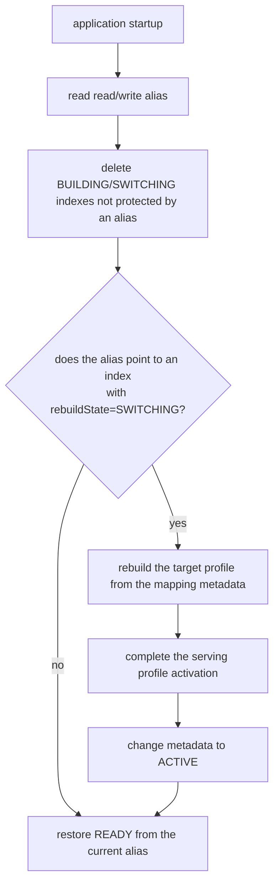

Restart semantics:

- Restart before the alias swap: the dirty set and progress are lost, the BUILDING target with no
  alias bound is cleaned up, and a complete rebuild is started again afterwards.
- Restart after the alias swap but before the profile is activated: the index the alias points to
  is still SWITCHING, and the startup logic completes the profile activation from the metadata.
- A failed ACTIVE metadata update does not affect the already completed alias/profile swap; the
  startup check still relies on the physical index the alias points to.

## 15. The old index and rollback

After a successful swap, the old physical index is not deleted immediately. It is kept only as a
static snapshot of the swap moment, because ordinary writes have already stopped registering and
synchronizing subsequent increments to it.

Pointing the alias back at the old index is not a safe rollback. To roll back, the additions,
updates, and deletes made after the swap must first be synchronized back to the old index, or
another target index must be built from the current new index as the source.

## 16. Runtime configuration

The parameters are stored in the generic runtime-config, all with type `REBUILD`. They can be
changed in the front end under "Settings → Runtime parameters → Index rebuild".

| Configuration | Default | Purpose |
| --- | ---: | --- |
| `rebuildSourceBatchSize` | 200 | Number of source documents per `search_after` page |
| `rebuildEmbeddingBatchSize` | 32 | Number of inputs per single text Embedding batch, 1–2048 allowed; does not affect the one-image-per-call policy |
| `rebuildEmbeddingConcurrency` | 2 | Maximum number of concurrent batches within the same page, 1–16 allowed, must respect the account concurrency quota |
| `rebuildEmbeddingRateLimitMaxAttempts` | 5 | Maximum number of attempts for a rate-limited batch |
| `rebuildEmbeddingRateLimitBackoffMs` | 5000 | Base for exponential backoff in milliseconds |
| `rebuildDirtyAssetLimit` | 100000 | Upper limit on the number of dirty Assets |

All values must be greater than zero; illegal values fail the rebuild. Changing the configuration
affects pages or phases that read the configuration afterwards; the target Embedding Session
itself is fixed at the start of the whole rebuild and does not change with the runtime
configuration or the active profile.

## 17. Consistency boundaries

The current implementation guarantees:

- Ordinary queries and ingestion keep using the old index during the backfill.
- Normal ingestion does not wait for the target model or for shadow index writes.
- Additions, updates, generation replacement, and Asset deletion all put the Asset into the dirty set.
- If the same Asset changes again during synchronization, it is not incorrectly removed from the dirty set.
- If a write occurs between the out-of-lock validation and the final locking, this swap attempt is cancelled and catch-up resumes.
- The final exclusive window performs no Embedding and no full scan.
- Ingestion with an old fingerprint that arrives across a swap regenerates vectors with the current profile.
- Vectors with the same dimension but a different fingerprint are never written directly to the new index.
- With consecutive profile switches, full re-vectorization runs at most 3 times and does not loop indefinitely.
- If profile activation fails, the alias returns to the old index.

The current implementation does not provide:

- a shared write barrier, distributed lock, or persistent dirty log across multiple JVMs;
- resuming a rebuild from a breakpoint;
- staged validation of the shadow index against live read traffic;
- continuous dual write to the old index after the swap and direct rollback;
- transactional behavior of Asset synchronization inside the shadow index;
- application-level batch retry for ordinary Elasticsearch failures;
- local test evidence for million-scale throughput, normal ingestion P95, and final pause time.
## 18. Test and acceptance status

The current automated tests already cover:

- dirty Assets merging into the latest sequence;
- `removeIfUnchanged` not deleting by mistake when the version changes during Asset synchronization;
- exceeding the dirty count limit only setting the tracker overflow;
- text projections being split into batches by configuration with a call count matching `ceil(projection count / batchSize)`;
- image projections running exactly one per batch without calling the per-entry `embed`;
- Embedding count, dimension, and finite-value validation;
- multimodal images generating only one `IMAGE_VISUAL`;
- old-fingerprint requests being re-vectorized with the current profile;
- consecutive fingerprint changes terminating after 3 re-vectorizations, without deleting or writing the generation before termination;
- input validation for generation replacement and the delete-then-write order;
- the `REBUILDING` state staying writable;
- concurrent confirmation of a rebuild task claiming it only once;
- Spring constructor wiring.

Still to be accepted on a real Elasticsearch and model environment:

1. With backfill threads blocked, ordinary ingestion can complete writes to the old index.
2. With concurrent additions, updates, generation replacement, and Asset deletion during the backfill, compare Asset by Asset after the swap.
3. Writes occurring both before and after the scan do not resurrect deleted data or overwrite new data.
4. Inject a write between the empty-dirty check and the final exclusive permit and confirm the swap is cancelled.
5. Force a restart after the alias swap but before profile activation and confirm startup self-healing.
6. Confirm the alias rollback when the alias/profile swap fails.
7. Million-scale backfill throughput, ingestion P95, dirty backlog, and final write pause duration.

Passing the local Maven tests only proves unit and in-process collaboration logic; when
Testcontainers is skipped, that cannot serve as a real Elasticsearch acceptance conclusion.

## 19. Code index

| Capability | Files |
| --- | --- |
| Rebuild orchestration and state | `SegmentIndexManagerImpl.java`, `SegmentIndexLifecycleState.java` |
| Shared/exclusive write barrier | `SegmentIndexWriteBarrier.java` |
| dirty Asset tracking | `SegmentRebuildMutationTracker.java` |
| Scanning, batch vectorization, and catch-up | `SegmentIndexMigrationRunner.java` |
| Target projection planning | `SegmentRebuildProjectionPlanner.java` |
| Physical index metadata | `SegmentPhysicalIndexFactory.java` |
| alias management | `SegmentIndexAliasManager.java` |
| Startup topology check and swap recovery | `SegmentIndexTopologyInspector.java` |
| Fixed Session for ingestion | `IngestionEmbeddingStage.java`, `IngestionEmbeddingPort.java` |
| profile fingerprint | `CapabilityEmbeddingProfileFactory.java`, `EmbeddingProfile.java` |
| Generation writes across a swap | `RetrievalGenerationIndexServiceImpl.java`, `RetrievalGenerationIndexRequest.java` |
| Batch Embedding Adapter | `ConfigDrivenEmbeddingAdapter.java`, `EmbeddingClient.java` |
| dirty capture for ordinary writes | `SearchSegmentBulkWriter.java`, `EsSegmentRepository.java` |
| REST status and entry points | `IndexController.java`, `SegmentIndexStatusDTO.java` |
| Rebuild runtime configuration | `SearchRebuildRuntimeSettings.java`, `SearchRuntimeConfigKey.java` |
